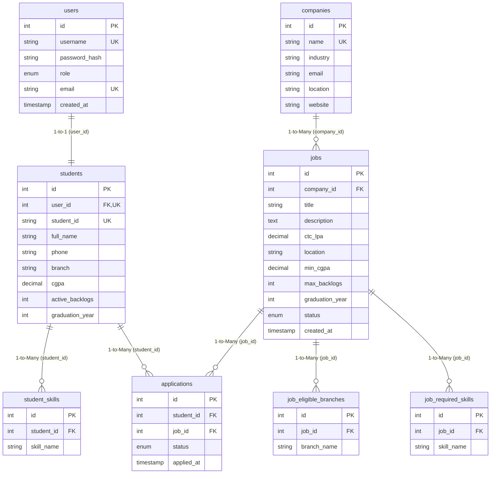

# NextStep — Database Architecture, Schema Design & SQL Operations

---

## 1. Database Fundamentals: Databases vs. Tables

During viva examinations, professors frequently test basic relational terminology. NextStep uses:

- **Database (1 Database):** A named container on the MySQL server that groups related tables, views, and indexes. NextStep uses **exactly one database** named **`nextstep_db`**.
- **Table (8 Tables):** A two-dimensional grid of rows and columns storing records for a specific business entity (e.g., `students`, `jobs`). NextStep contains **exactly 8 tables**.
- **Column (Field):** An individual attribute defined with a specific data type (e.g., `cgpa DECIMAL(3,2)`, `email VARCHAR(100)`).
- **Row (Record / Tuple):** A single horizontal entry representing one entity instance (e.g., one student's profile).
- **Primary Key (PK):** A column (or set of columns) that uniquely identifies each row in a table. NextStep uses `INT AUTO_INCREMENT` for all primary keys.
- **Foreign Key (FK):** A column that establishes a formal referential link to the primary key of another table, ensuring data consistency.

---

## 2. Complete Inventory of Tables

All 8 tables are defined in [`database/schema.sql`](file:///c:/Semister-3/Programming%20in%20Java/JavaProjects/NextStep-Campus-Recruitment-System/database/schema.sql) with the `InnoDB` storage engine:

| # | Table Name | Business Entity / Purpose | Primary Key | Foreign Keys | Key Constraints |
|:---:|---|---|:---:|:---:|---|
| **1** | `users` | User credentials, roles, and hashed passwords | `id` | None | `UNIQUE(username)`, `UNIQUE(email)` |
| **2** | `students` | Academic profiles (USN, CGPA, backlogs) | `id` | `user_id` $\rightarrow$ `users(id)` | `UNIQUE(user_id)`, `UNIQUE(student_id)` (1-to-1 with users), `ON DELETE CASCADE` |
| **3** | `student_skills` | Normalized technical skills of students | `id` | `student_id` $\rightarrow$ `students(id)` | `UNIQUE(student_id, skill_name)`, `ON DELETE CASCADE` |
| **4** | `companies` | Corporate hiring partners directory | `id` | None | `UNIQUE(name)` |
| **5** | `jobs` | Job postings and eligibility cutoffs | `id` | `company_id` $\rightarrow$ `companies(id)` | `ON DELETE RESTRICT` (Protects past drives) |
| **6** | `job_eligible_branches` | Degree branches eligible for a specific job | `id` | `job_id` $\rightarrow$ `jobs(id)` | `UNIQUE(job_id, branch_name)`, `ON DELETE CASCADE` |
| **7** | `job_required_skills` | Mandatory technical skills for a specific job | `id` | `job_id` $\rightarrow$ `jobs(id)` | `UNIQUE(job_id, skill_name)`, `ON DELETE CASCADE` |
| **8** | `applications` | Digital student application filing & status | `id` | `student_id` $\rightarrow$ `students(id)`, `job_id` $\rightarrow$ `jobs(id)` | `UNIQUE(student_id, job_id)` (Prevents duplicate applications!), `ON DELETE RESTRICT` |

---

## 3. Entity-Relationship (ER) Diagram



---

## 4. Normalization Breakdown (Third Normal Form — 3NF)

NextStep was designed following strict database normalization principles:

### First Normal Form (1NF) — Atomic Values
- **Violation Avoided:** Storing multiple skills as a single comma-separated text column (e.g. `skills = "Java, SQL, Git"` inside `students`) violates 1NF because the values are not atomic. Searching for students with "Java" would require slow, inefficient `LIKE '%Java%'` substring queries.
- **NextStep Solution:** Created normalized child tables `student_skills` and `job_required_skills`. Each skill is stored as an independent, atomic row.

### Second Normal Form (2NF) — Full Functional Dependency
- Every non-key column depends completely on the entire primary key. In child tables with composite uniqueness constraints (e.g., `student_skills`), the skill is functionally dependent on the specific student ID.

### Third Normal Form (3NF) — No Transitive Dependencies
- In `applications`, we store only `student_id` and `job_id`. We do not duplicate the company name or student's CGPA inside `applications`. To retrieve the company name for an application, Java executes an SQL `JOIN` across `applications`, `jobs`, and `companies`.

---

## 5. Detailed Table Definitions & SQL DDL

### Table 1: `users`
```sql
CREATE TABLE IF NOT EXISTS users (
    id INT AUTO_INCREMENT PRIMARY KEY,
    username VARCHAR(50) NOT NULL UNIQUE,
    password_hash VARCHAR(255) NOT NULL,
    role ENUM('STUDENT', 'PLACEMENT_OFFICER') NOT NULL,
    email VARCHAR(100) NOT NULL UNIQUE,
    created_at TIMESTAMP DEFAULT CURRENT_TIMESTAMP,
    INDEX idx_users_username (username),
    INDEX idx_users_email (email)
) ENGINE=InnoDB;
```
- **Java Access:** [`UserDAO.java`](file:///c:/Semister-3/Programming%20in%20Java/JavaProjects/NextStep-Campus-Recruitment-System/src/com/nextstep/dao/UserDAO.java).

### Table 2: `students`
```sql
CREATE TABLE IF NOT EXISTS students (
    id INT AUTO_INCREMENT PRIMARY KEY,
    user_id INT NOT NULL UNIQUE,
    student_id VARCHAR(30) NOT NULL UNIQUE, -- University Roll No / USN (e.g. 2510990750)
    full_name VARCHAR(100) NOT NULL,
    phone VARCHAR(15) NOT NULL,
    branch VARCHAR(50) NOT NULL,
    cgpa DECIMAL(3, 2) NOT NULL,            -- Bounds: 0.00 to 10.00
    active_backlogs INT NOT NULL DEFAULT 0,
    graduation_year INT NOT NULL,
    FOREIGN KEY (user_id) REFERENCES users(id) ON DELETE CASCADE,
    INDEX idx_students_student_id (student_id),
    INDEX idx_students_branch (branch),
    INDEX idx_students_cgpa (cgpa)
) ENGINE=InnoDB;
```
- **Java Access:** [`StudentDAO.java`](file:///c:/Semister-3/Programming%20in%20Java/JavaProjects/NextStep-Campus-Recruitment-System/src/com/nextstep/dao/StudentDAO.java).

### Table 3: `student_skills`
```sql
CREATE TABLE IF NOT EXISTS student_skills (
    id INT AUTO_INCREMENT PRIMARY KEY,
    student_id INT NOT NULL,
    skill_name VARCHAR(50) NOT NULL,
    FOREIGN KEY (student_id) REFERENCES students(id) ON DELETE CASCADE,
    CONSTRAINT uq_student_skill UNIQUE (student_id, skill_name),
    INDEX idx_student_skills_skill (skill_name)
) ENGINE=InnoDB;
```

### Table 4: `companies`
```sql
CREATE TABLE IF NOT EXISTS companies (
    id INT AUTO_INCREMENT PRIMARY KEY,
    name VARCHAR(100) NOT NULL UNIQUE,
    industry VARCHAR(50) NOT NULL,
    email VARCHAR(100) NOT NULL,
    location VARCHAR(100) NOT NULL,
    website VARCHAR(100) NULL,
    INDEX idx_companies_name (name)
) ENGINE=InnoDB;
```
- **Java Access:** [`CompanyDAO.java`](file:///c:/Semister-3/Programming%20in%20Java/JavaProjects/NextStep-Campus-Recruitment-System/src/com/nextstep/dao/CompanyDAO.java).

### Table 5: `jobs`
```sql
CREATE TABLE IF NOT EXISTS jobs (
    id INT AUTO_INCREMENT PRIMARY KEY,
    company_id INT NOT NULL,
    title VARCHAR(100) NOT NULL,
    description TEXT NOT NULL,
    ctc_lpa DECIMAL(10, 2) NOT NULL,        -- CTC in Lakhs Per Annum (e.g. 12.00)
    location VARCHAR(100) NOT NULL,
    min_cgpa DECIMAL(3, 2) NOT NULL DEFAULT 0.00,
    max_backlogs INT NOT NULL DEFAULT 0,
    graduation_year INT NOT NULL,
    status ENUM('OPEN', 'CLOSED') NOT NULL DEFAULT 'OPEN',
    created_at TIMESTAMP DEFAULT CURRENT_TIMESTAMP,
    FOREIGN KEY (company_id) REFERENCES companies(id) ON DELETE RESTRICT,
    INDEX idx_jobs_company (company_id),
    INDEX idx_jobs_status (status)
) ENGINE=InnoDB;
```
- **Java Access:** [`JobDAO.java`](file:///c:/Semister-3/Programming%20in%20Java/JavaProjects/NextStep-Campus-Recruitment-System/src/com/nextstep/dao/JobDAO.java).

### Table 6: `job_eligible_branches`
```sql
CREATE TABLE IF NOT EXISTS job_eligible_branches (
    id INT AUTO_INCREMENT PRIMARY KEY,
    job_id INT NOT NULL,
    branch_name VARCHAR(50) NOT NULL,
    FOREIGN KEY (job_id) REFERENCES jobs(id) ON DELETE CASCADE,
    CONSTRAINT uq_job_branch UNIQUE (job_id, branch_name)
) ENGINE=InnoDB;
```

### Table 7: `job_required_skills`
```sql
CREATE TABLE IF NOT EXISTS job_required_skills (
    id INT AUTO_INCREMENT PRIMARY KEY,
    job_id INT NOT NULL,
    skill_name VARCHAR(50) NOT NULL,
    FOREIGN KEY (job_id) REFERENCES jobs(id) ON DELETE CASCADE,
    CONSTRAINT uq_job_skill UNIQUE (job_id, skill_name)
) ENGINE=InnoDB;
```

### Table 8: `applications`
```sql
CREATE TABLE IF NOT EXISTS applications (
    id INT AUTO_INCREMENT PRIMARY KEY,
    student_id INT NOT NULL,
    job_id INT NOT NULL,
    status ENUM('APPLIED', 'SHORTLISTED', 'SELECTED', 'REJECTED') NOT NULL DEFAULT 'APPLIED',
    applied_at TIMESTAMP DEFAULT CURRENT_TIMESTAMP,
    FOREIGN KEY (student_id) REFERENCES students(id) ON DELETE RESTRICT,
    FOREIGN KEY (job_id) REFERENCES jobs(id) ON DELETE RESTRICT,
    CONSTRAINT uq_student_job UNIQUE (student_id, job_id),
    INDEX idx_applications_student (student_id),
    INDEX idx_applications_job (job_id),
    INDEX idx_applications_status (status)
) ENGINE=InnoDB;
```
- **Java Access:** [`ApplicationDAO.java`](file:///c:/Semister-3/Programming%20in%20Java/JavaProjects/NextStep-Campus-Recruitment-System/src/com/nextstep/dao/ApplicationDAO.java).

---

## 6. How to Set Up & Inspect the Database

### Initializing the Database via MySQL CLI
In Windows PowerShell or CMD:
```powershell
# 1. Log in to MySQL as root
mysql -u root -p

# 2. Source the schema file
mysql> source C:/Semister-3/Programming in Java/JavaProjects/NextStep-Campus-Recruitment-System/database/schema.sql;

# 3. Source sample data (Companies, Jobs, Skills)
mysql> source C:/Semister-3/Programming in Java/JavaProjects/NextStep-Campus-Recruitment-System/database/sample_data.sql;

# 4. Verify tables exist
mysql> USE nextstep_db;
mysql> SHOW TABLES;
```

### Inspecting Data via SQL Queries
```sql
-- View all registered students with their User IDs
SELECT s.student_id, s.full_name, s.branch, s.cgpa, u.username, u.email 
FROM students s 
JOIN users u ON s.user_id = u.id;

-- View all open job drives with company names and CTC
SELECT j.id, c.name AS company, j.title, j.ctc_lpa, j.min_cgpa, j.max_backlogs 
FROM jobs j 
JOIN companies c ON j.company_id = c.id;

-- View all applications submitted with real-time status
SELECT a.id AS app_id, s.student_id AS usn, s.full_name, j.title, a.status, a.applied_at 
FROM applications a 
JOIN students s ON a.student_id = s.id 
JOIN jobs j ON a.job_id = j.id;
```
