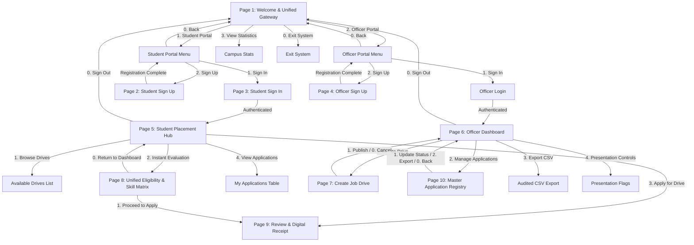

# 📘 NextStep — Demonstration & Operational User Manual

> **Course:** Programming in Java (25CSE0202) — Continuous Assessment (CA-3)  
> **Project:** NextStep — Campus Recruitment System  
> **Repository:** [https://github.com/raghavbansal9518-cloud/NextStep-Campus-Recruitment-System](https://github.com/raghavbansal9518-cloud/NextStep-Campus-Recruitment-System)  
> **Application Type:** Core Java Console Application + MySQL Database (JDBC)  
> **Author:** Raghav Bansal & Project Team

---

## 🎯 About This Manual

This manual is a practical, step-by-step guide designed for **live evaluation demonstrations, laboratory presentations, and project walkthroughs** with professors, evaluators, classmates, and teammates.

Keep this document open during your demo. It contains:
- Exact copy-ready sample data that matches database constraints.
- Step-by-step screen navigation covering Pages 1 through 10.
- Detailed explanations of all working application startup methods.
- A scripted 5-to-10 minute presentation sequence with spoken talking points.
- A pre-demonstration verification checklist.

---

## Table of Contents

1. [A. Before Starting — Setup & Verification](#a-before-starting--setup--verification)
2. [B. All Supported Ways to Start NextStep](#b-all-supported-ways-to-start-nextstep)
3. [C. Complete Application Navigation Guide (Pages 1–10)](#c-complete-application-navigation-guide-pages-110)
4. [D. Ready-to-Use Demonstration Data](#d-ready-to-use-demonstration-data)
5. [E. Placement Officer Activation Code Guide](#e-placement-officer-activation-code-guide)
6. [F. GitHub Collaboration Guide for Teammates](#f-github-collaboration-guide-for-teammates)
7. [G. Common Problems & Quick Fixes](#g-common-problems--quick-fixes)
8. [H. Suggested 5-to-10 Minute Live College Demo Script](#h-suggested-5-to-10-minute-live-college-demo-script)
9. [I. Final Pre-Demo Inspection Checklist](#i-final-pre-demo-inspection-checklist)

---

## A. Before Starting — Setup & Verification

Before launching NextStep for an evaluation or demo, ensure the following components are ready.

### One-Time Setup vs. Per-Session Actions

| Component | Frequency | What to Do |
| :--- | :---: | :--- |
| **Java JDK (17+)** | **One-time** | Install JDK 17, 21, or newer. Ensure `java -version` and `javac -version` output valid versions in your terminal. |
| **MySQL Server (8.0+)** | **One-time** | Install MySQL Community Server. Ensure the `MySQL80` Windows service is running. |
| **Database & Tables** | **One-time** | Run `database/schema.sql` and `database/sample_data.sql` to initialize `nextstep_db` and seed test companies and drives. |
| **Connector/J JAR** | **One-time** | Confirm that `lib/mysql-connector-j-8.4.0.jar` is present in the repository. |
| **`config/db.properties`** | **One-time** | Copy `config/db.properties.example` to `config/db.properties` and set your local MySQL password. |
| **Officer Activation Code** | **One-time** | Set `NEXTSTEP_OFFICER_ACTIVATION_CODE` via `setx` in Windows so officer registration works permanently. |
| **Application Launch** | **Per-session** | Double-click `run.bat` or run the PowerShell/CMD launch command whenever you present. |

---

## B. All Supported Ways to Start NextStep

NextStep supports four verified launch methods on Windows. Choose the method most convenient for your presentation environment.

```
+-------------------------------------------------------------------------------+
|                        HOW DO YOU WANT TO LAUNCH?                             |
+------------------------------------+------------------------------------------+
|  1. Fast Double-Click (GUI)        | Double-click run.bat in File Explorer    |
|  2. PowerShell (Automated)         | .\run.bat                                |
|  3. Command Prompt (Automated)     | run.bat                                  |
|  4. Manual Java Commands (Pure)    | javac -cp ... && java -cp ...            |
+------------------------------------+------------------------------------------+
```

---

### Method 1: Double-Click `run.bat` in File Explorer (Easiest)

- **Where:** Open File Explorer and navigate to the NextStep project root directory (where you cloned the repository).
- **Action:** Double-click the file named **`run.bat`**.
- **What happens:**
  1. A Command Prompt window opens automatically.
  2. The script switches to the project root directory (`%~dp0`).
  3. It verifies `javac`, `java`, `lib/mysql-connector-j-8.4.0.jar`, and `config/db.properties`.
  4. It compiles all Java source files into `bin/`.
  5. It launches `com.nextstep.Main`.
- **How to recognize success:** The Welcome Page banner appears with borders in cyan (`#6FC9FF`), options in slate (`#CAD5E5`), and the prompt `Enter your choice: ` in gold (`#E3B341`).
- **How to stop:** Enter `0` at the prompt to exit cleanly, or press `Ctrl + C`.

---

### Method 2: Running `.\run.bat` in Windows PowerShell

- **Where:** Open PowerShell inside the project root folder.
- **Command:**
  ```powershell
  .\run.bat
  ```
- **What happens:** PowerShell delegates to the Windows batch processor. Sources are re-compiled and NextStep starts interactively.
- **How to stop:** Enter `0` at any menu or press `Ctrl + C`.

---

### Method 3: Running `run.bat` in Command Prompt (CMD)

- **Where:** Open CMD inside the project root folder.
- **Command:**
  ```cmd
  run.bat
  ```
- **What happens:** Identical to Method 2. Runs the pre-flight checks, compiles bytecode to `bin/`, and starts the main application loop.

---

### Method 4: Manual Compilation & Execution (Evaluator Inspection)

If an evaluator asks to see raw command-line compilation without helper scripts:

#### In Windows PowerShell:
```powershell
# 1. Compile all source packages into bin/
javac -cp "lib/*;src" -d bin (Get-ChildItem -Path src -Recurse -Filter *.java | ForEach-Object { $_.FullName })

# 2. Run the application
java -cp "bin;lib/*" com.nextstep.Main
```

#### In Windows Command Prompt (CMD):
```cmd
:: 1. Compile source packages into bin/
javac -d bin -cp "lib\mysql-connector-j-8.4.0.jar" src\com\nextstep\model\*.java src\com\nextstep\database\*.java src\com\nextstep\dao\*.java src\com\nextstep\service\*.java src\com\nextstep\util\*.java src\com\nextstep\Main.java

:: 2. Run the application
java -cp "bin;lib\mysql-connector-j-8.4.0.jar" com.nextstep.Main
```

#### With JVM System Property for Activation Code (Per-Session Override):
```powershell
java "-Dnextstep.officer.activation.code=CAMPUS_OFFICER_2026" -cp "bin;lib/*" com.nextstep.Main
```

---

## C. Complete Application Navigation Guide (Pages 1–10)

NextStep implements an evaluator-approved 10-page console interface featuring strict 64-character rectangular box frames, 24-bit TrueColour ANSI borders, Golden Amber field prompt labels (`#E3B341`), and inline Sky Blue autofill values (`#6FC9FF`).



---

### Page 1 — Welcome & Unified Campus Gateway

- **Screen Header:** `NEXTSTEP | CAMPUS RECRUITMENT SYSTEM (2026)` / `WELCOME & UNIFIED CAMPUS GATEWAY`
- **Purpose:** Central unified entry point with live campus recruitment statistics and direct role dispatching. Completely removes the legacy redundant splash screen.
- **Available Options:**
  - `1. Student Portal` — Dispatches to the Student Portal workflow menu (Sign In / Sign Up).
  - `2. Placement Officer Portal` — Dispatches to the Placement Officer workflow menu (Sign In / Sign Up).
  - `3. View Campus Recruitment Statistics` — Instant on-screen display of live drive and applicant metrics.
  - `0. Exit System` — Terminates the application cleanly.
- **Framing & Styling:** Full 64-character outer rectangular border in Cyan (`#6FC9FF`) with live metrics and menu items in Slate (`#CAD5E5`).

---

### Page 2 — Student Sign Up

- **Screen Header:** `NEXTSTEP | STUDENT PORTAL — STUDENT REGISTRATION`
- **Purpose:** Self-service registration for college students.
- **Upfront Mode Selection:**
  - Prompts: `Choose mode (or press 0 to Cancel): [A] Quick Auto-Fill Demo Data | [ENTER] Fill Form Manually`
  - Selecting `[A]` activates One-Click Demo Autofill with realistic college profiles (Vihaan Mehta `2510990750`, Kabir Malhotra, Ishaan Verma, or Arjun Khanna).
  - Values render inline directly beside Golden Amber prompts in Sky Blue brackets `[Value]`.
  - Pressing `[Enter]` confirms and retains each autofilled value; typing overrides with custom data.
- **Input Fields (12 fields, prompt labels aligned at column 25):**
  1. `Student ID:             ` (University Roll No / USN, e.g., `2510990750`)
  2. `Full Name:              ` (Student's full legal name, e.g., `Vihaan Mehta`)
  3. `Email:                  ` (Valid RFC-compliant email, e.g., `vihaan.2510990750@university.edu`)
  4. `Phone Number:           ` (10-digit mobile number, e.g., `9876543210`)
  5. `Branch:                 ` (e.g., `Computer Science`, `Information Technology`)
  6. `CGPA:                   ` (Decimal between `0.00` and `10.00`, e.g., `8.75`)
  7. `Technical Skills:       ` (Comma-separated list, e.g., `Java, Spring Boot, MySQL, Git, REST APIs, Microservices`)
  8. `Active Backlogs:        ` (Integer greater than or equal to zero, e.g., `0`)
  9. `Graduation Year:        ` (Target graduation year, e.g., `2026`)
  10. `Username:               ` (3 to 30 alphanumeric characters, e.g., `vihaan_2510`)
  11. `Password:               ` (Masked input, minimum 6 characters; auto-generated via SecureRandom)
  12. `Confirm Password:       ` (Masked input, matches generated password)
- **Live Collision Safety:** The system dynamically queries MySQL (`users.username`, `students.student_id`, and `users.email`) up to 1,000 attempts to guarantee uniqueness. If a database error occurs, autofill safely aborts with an error notice rather than returning unverified data.
- **Footer Actions:**
  - `1. CREATE ACCOUNT (SUBMIT REGISTRATION)` — Validates inputs, encrypts password via PBKDF2 with 16-byte random salt, and persists records atomically in MySQL (`users`, `students`, and `student_skills` tables).
  - `0. BACK (CANCEL & RETURN)` — Aborts account creation and returns safely to the Student Portal Menu.

---

### Page 3 — Student Sign In

- **Screen Header:** `NEXTSTEP | STUDENT PORTAL — STUDENT SIGN IN`
- **Purpose:** Dual-auth gateway supporting both Username and University Roll Number (USN).
- **Input Fields:**
  1. `Student ID / Username:  ` (Accepts either Username or USN, e.g., `vihaan_2510` or `2510990750`)
  2. `Password:               ` (Masked input via `System.console().readPassword()`)
- **One-Click Demo Autofill:** Enter `A` at the mode prompt to immediately populate verified demo credentials (`vihaan_2510` / temporary password).
- **Footer Actions:**
  - `1. SIGN IN` — Authenticates PBKDF2 hash, verifies `STUDENT` role, loads student profile from MySQL, and opens Page 5 (Student Placement Hub).
  - `0. BACK TO ROLE SELECT` — Returns to Student Portal Menu / Gateway.
- **Access Control:** Placement officer credentials entered here are rejected with a clear access denial notice (`Placement officer accounts cannot sign in here`).

---

### Page 4 — Placement Officer Sign Up

- **Screen Header:** `NEXTSTEP | PLACEMENT OFFICER PORTAL — OFFICER SIGN UP`
- **Purpose:** Authorized administrator onboarding with safe activation code verification.
- **Upfront Mode Selection:** Prompts `[A] Quick Auto-Fill Demo Data | [ENTER] Fill Form Manually`.
- **Input Fields (7 fields):**
  1. `Officer ID:             ` (Administrative employee code, e.g., `OFF-2026-01`)
  2. `Full Name:              ` (Officer's full name, e.g., `Prof. Vihaan Mehta`)
  3. `Official Email:         ` (Official campus email, e.g., `tpo.vihaan@university.edu`)
  4. `Username:               ` (Unique officer username, e.g., `officer_vihaan`)
  5. `Password:               ` (Masked password, min 6 characters; auto-generated via SecureRandom)
  6. `Confirm Password:       ` (Masked confirmation)
  7. `Activation Code:        ` (Masked administrative secret)
- **Zero-Secret Autofill Safety:** Reads activation code strictly from `-Dnextstep.officer.activation.code` or `NEXTSTEP_OFFICER_ACTIVATION_CODE`. If unconfigured, the field remains empty with the notice `[NOT CONFIGURED — ENTER MANUALLY]` instead of populating a guessable hardcoded default.
- **Footer Actions:**
  - `1. CREATE ACCOUNT (SUBMIT REGISTRATION)` — Persists officer user account with `PLACEMENT_OFFICER` role in MySQL.
  - `0. BACK (CANCEL & RETURN)` — Returns to Placement Officer Portal Menu.

---

### Page 5 — Student Placement Hub

- **Screen Header:** `NEXTSTEP | PLACEMENT HUB — STUDENT DASHBOARD`
- **Profile Card:** Aligned 64-character profile block displaying Student Name, Student ID (USN), CGPA, Branch, and Backlogs directly from MySQL.
- **Available Tools:**
  - `1. Browse Available Placement Drives` — Displays open job openings sorted by CTC (highest first).
  - `2. Instant Eligibility & Technical Match Evaluation` — Prompts for Job ID and opens Page 8 (Unified Eligibility & Skill Match Matrix).
  - `3. Apply for Verified Placement Opening` — Prompts for Job ID and opens Page 9 (Application Review & Digital Receipt).
  - `4. View Submitted Applications & Status` — Displays candidate's personal submitted application history table.
  - `0. Sign Out / Lock Session` — Clears active session and returns to Page 1 (Gateway).

---

### Page 6 — Placement Officer Administration Dashboard

- **Screen Header:** `NEXTSTEP | ADMINISTRATION DASHBOARD — OFFICER DASHBOARD`
- **Profile Card & Live Metrics:** Displays authenticated officer name and live database counts (Active Drives, Registered Candidates, Applications Filed, Average Offered CTC).
- **Administrative Tools:**
  - `1. Create & Publish Verified Placement Drive` — Opens Page 7 (Create Job Drive).
  - `2. Manage Student Applications & Update Status` — Opens Page 10 (Master Application Registry) with candidate status update workflow.
  - `3. Export Application Records (RFC-4180 CSV)` — Exports verified student application dataset to an audited CSV file.
  - `4. Campus Placement Presentation Controls` — Toggles presentation flags for lab demonstrations.
  - `0. Sign Out / Lock Session` — Clears session and returns to Page 1 (Gateway).

---

### Page 7 — Create Job Drive

- **Screen Header:** `NEXTSTEP | PLACEMENT OFFICER PORTAL — CREATE JOB DRIVE`
- **Live Company Lookup:** Dynamically queries MySQL and displays registered partner companies:
  ```text
  Available Partner Companies (Select by ID):
    [ID 1] Nexis Cloud Technologies       | Cloud Infrastructure   | Bengaluru, KA
    [ID 2] Apex Financial Software        | Fintech & Banking      | Mumbai, MH
    [ID 3] Quantum Robotics Labs          | AI & Robotics          | Hyderabad, TS
  ```
- **Upfront Mode Selection:** Prompts `[A] Quick Auto-Fill Demo Data | [ENTER] Fill Form Manually`.
- **Input Fields (10 parameters):**
  1. `Company ID:             ` (Select ID from displayed partner list, e.g., `1`)
  2. `Job Title:              ` (e.g., `Associate Cloud Engineer`)
  3. `Job Description:        ` (e.g., `Design, build, and maintain cloud infrastructure on AWS and GCP.`)
  4. `CTC (LPA):              ` (Package in LPA, e.g., `12.50`)
  5. `Job Location:           ` (Job location, e.g., `Bengaluru, KA`)
  6. `Minimum CGPA:           ` (Cutoff, e.g., `7.20`)
  7. `Max Active Backlogs:    ` (Maximum allowed active backlogs, e.g., `0`)
  8. `Eligible Branches:      ` (Comma-separated, e.g., `Computer Science, Information Technology`)
  9. `Required Skills:        ` (Comma-separated, e.g., `Java, SQL, Linux, Git, Docker`)
  10. `Graduation Year:        ` (Target batch, e.g., `2026`)
- **Footer Actions:**
  - `1. PUBLISH JOB (POST TO STUDENTS)` — Atomically inserts `jobs`, `job_eligible_branches`, and `job_required_skills` records into MySQL.
  - `0. CANCEL (DISCARD)` — Aborts drive creation and prints `Job drive creation cancelled. Returning to Placement Officer Dashboard...`.

---

### Page 8 — Unified Eligibility & Skill Match Matrix

- **Screen Header:** `NEXTSTEP | ELIGIBILITY & SKILL EVALUATION ENGINE`
- **Unified Screen Layout:** Combines academic checklist and technical skill matching into a single 64-character screen.
  - **Part A — Academic Eligibility Checklist Table:** Evaluates CGPA cutoff, Active Backlogs, Eligible Branches, and Graduation Year against drive criteria (`PASS` / `FAIL`).
  - **Part B — Technical Skills Breakdown Table:** Compares candidate skills with required drive skills, displaying `[MATCH]` (green) or `[MISSING]` (red), Matched Skills ratio (`3 / 4`), and Match Percentage (`75%`).
  - **Overall Evaluation Banner:**
    - `[ELIGIBLE FOR THIS DRIVE] (OVERALL RESULT: ELIGIBLE)` (green)
    - `[NOT ELIGIBLE FOR THIS DRIVE] (OVERALL RESULT: NOT ELIGIBLE)` (red)
- **Footer Actions:**
  - `1. PROCEED TO SUBMIT APPLICATION` (or `2. APPLY FOR THIS JOB`) — Offered when candidate is eligible; transitions directly to Page 9.
  - `0. RETURN TO DASHBOARD` (or `0. BACK`) — Returns to Page 5 (Student Placement Hub).

---

### Page 9 — Application Review & Digital Receipt

- **Screen Header:** `NEXTSTEP | APPLICATION CONFIRMATION & DIGITAL RECEIPT`
- **Dual-State Workflow:**
  - **State A — Application Review Summary:**
    - Displays Candidate USN, Applying For Position, Company Name, Offered CTC, and Verified Academic & Skill Eligibility.
    - Prompts: `1. CONFIRM APPLICATION` / `0. CANCEL`.
  - **State B — Instant Success Digital Receipt Voucher:**
    - Rendered immediately upon atomic MySQL persistence.
    - Formatted 64-character official digital receipt voucher displaying:
      - Application ID: `APP-2026-XXX`
      - Submission Timestamp: `2026-11-21 23:15:00`
      - Position & Company: `Associate Cloud Engineer @ Nexis Cloud Technologies`
      - Initial Review Status: `APPLIED` (Cyan pill)
- **Safety Guards:**
  - Prevents ineligible applications from being filed.
  - Enforces duplicate prevention via database constraint `uq_student_job`.

---

### Page 10 — Master Application Registry

- **Screen Header:** `NEXTSTEP | MASTER APPLICATION REGISTRY — ALL CANDIDATES`
- **Security Check:** Restricts access strictly to authenticated Placement Officers.
- **Corporate 64-Column Table:** Displays Application ID, Student ID, Candidate Name (expanded to 20 characters to prevent truncation), and ANSI status pills:
  - `APPLIED` (Cyan)
  - `SHORTLISTED` (Green)
  - `REJECTED` (Red)
- **Available Actions:**
  - `1. Update Candidate Status` — Prompts for Application ID and advances candidate status (`APPLIED` → `SHORTLISTED` → `SELECTED` / `REJECTED`).
  - `2. Export Application Registry (RFC-4180 CSV)` — Exports complete application dataset to an audited CSV file.
  - `0. Return to Placement Officer Dashboard` — Returns to Page 6.

---

## D. Ready-to-Use Demonstration Data

Use these prepared, copy-ready records during live evaluation presentations. All values strictly conform to database types, constraints, and validation regexes. Alternatively, simply type `'A'` on any form prompt to autofill these verified profiles instantly!

---

### 1. Student Registration Demo Profiles (Passes All Validations)

#### Profile 1: Vihaan Mehta (Primary Demo Candidate — CS Stream)
```text
Student ID:             2510990750
Full Name:              Vihaan Mehta
Email:                  vihaan.2510990750@university.edu
Phone Number:           9876543210
Branch:                 Computer Science
CGPA:                   8.75
Technical Skills:       Java, Spring Boot, MySQL, Git, REST APIs, Microservices
Active Backlogs:        0
Graduation Year:        2026
Username:               vihaan_2510
Password:               (Generated at runtime via SecureRandom)
Confirm Password:       (Matches generated password)
```

#### Profile 2: Kabir Malhotra (IT Stream)
```text
Student ID:             2510990751
Full Name:              Kabir Malhotra
Email:                  kabir.2510990751@university.edu
Phone Number:           9876543211
Branch:                 Information Technology
CGPA:                   8.50
Technical Skills:       Java, Python, Docker, Kubernetes, AWS, SQL
Active Backlogs:        0
Graduation Year:        2026
Username:               kabir_2510
Password:               (Generated at runtime via SecureRandom)
Confirm Password:       (Matches generated password)
```

#### Profile 3: Ishaan Verma (High CGPA Candidate)
```text
Student ID:             2510990752
Full Name:              Ishaan Verma
Email:                  ishaan.2510990752@university.edu
Phone Number:           9876543212
Branch:                 Computer Science
CGPA:                   8.90
Technical Skills:       Java, DSA, System Design, React, Node.js, SQL
Active Backlogs:        0
Graduation Year:        2026
Username:               ishaan_2510
Password:               (Generated at runtime via SecureRandom)
Confirm Password:       (Matches generated password)
```

#### Profile 4: Arjun Khanna (ECE Stream / 1 Backlog — For Ineligibility Testing)
```text
Student ID:             2510990753
Full Name:              Arjun Khanna
Email:                  arjun.2510990753@university.edu
Phone Number:           9876543213
Branch:                 Electronics & Communication
CGPA:                   8.20
Technical Skills:       C++, Java, Embedded Systems, IoT, Linux, Git
Active Backlogs:        1
Graduation Year:        2026
Username:               arjun_2510
Password:               (Generated at runtime via SecureRandom)
Confirm Password:       (Matches generated password)
```

---

### 2. Placement Officer Registration Data

```text
Officer ID:             OFF-2026-01
Full Name:              Prof. Vihaan Mehta
Official Email:         tpo.vihaan@university.edu
Username:               officer_vihaan
Password:               (Generated at runtime via SecureRandom)
Confirm Password:       (Matches generated password)
Activation Code:        CAMPUS_OFFICER_2026
```
*(Ensure `CAMPUS_OFFICER_2026` matches your configured environment variable or `-Dnextstep.officer.activation.code` before presenting).*

---

### 3. Job Drive Creation Data (Page 7)

Use real Company ID `1` (`Nexis Cloud Technologies`) from the seeded database:

```text
Company ID:             1
Job Title:              Associate Cloud Engineer
Job Description:        Design, build, and maintain cloud infrastructure on AWS and GCP.
CTC (LPA):              12.50
Job Location:           Bengaluru, KA
Minimum CGPA:           7.20
Max Active Backlogs:    0
Eligible Branches:      Computer Science, Information Technology
Required Skills:        Java, SQL, Linux, Git, Docker
Graduation Year:        2026
```

---

### 4. Eligibility Demonstration: Pass vs. Fail Case

#### Case A: Eligible Student (PASS)
- **Student Profile:** Vihaan Mehta (`2510990750`)
  - Branch: `Computer Science`
  - CGPA: `8.75`
  - Active Backlogs: `0`
  - Graduation Year: `2026`
- **Target Drive:** Job ID `1` (`Junior Backend Engineer` at Nexis Cloud Technologies)
  - Requires: Min CGPA `7.50`, Max Backlogs `0`, Branch `Computer Science` / `IT`, Year `2026`.
- **Expected Result on Page 8 (Unified Matrix):** All criteria display `[PASS]`, and overall banner displays `[ELIGIBLE FOR THIS DRIVE] (OVERALL RESULT: ELIGIBLE)` in green.

#### Case B: Ineligible Student (FAIL)
- **Student Profile:** Arjun Khanna (`2510990753`)
  - Branch: `Electronics & Communication`
  - CGPA: `8.20`
  - Active Backlogs: `1`
  - Graduation Year: `2026`
- **Target Drive:** Job ID `1` (Requires: Max Backlogs `0`, Branch `CSE, IT`)
- **Expected Result on Page 8 (Unified Matrix):**
  - CGPA (`8.20 >= 7.50`): `[PASS]`
  - Backlogs (`1 > 0`): `[FAIL]`
  - Branch (`Electronics & Communication` not in `CSE, IT`): `[FAIL]`
  - Graduation Year (`2026 == 2026`): `[PASS]`
  - Overall Banner displays `[NOT ELIGIBLE FOR THIS DRIVE] (OVERALL RESULT: NOT ELIGIBLE)` in red. Submission is blocked on Page 9.

---

### 5. Technical Skill Match Demonstration (Page 8)

- **Job Required Skills:** `Java, SQL, OOP, Git` (Total: 4)
- **Student Skills (Vihaan Mehta):** `Java, Spring Boot, MySQL, Git, REST APIs, Microservices`
- **Calculated Result:**
  - Matched: `Java` [MATCH], `Git` [MATCH] (2 matched)
  - Missing: `SQL`, `OOP` [MISSING]
  - Match Percentage: `Math.round((2 / 4) * 100) = 50%`

---

### 6. Application Lifecycle & Duplicate Prevention Demonstration

1. Sign in as student `vihaan_2510` (Page 3).
2. Choose Option `3. Apply for Verified Placement Opening` from Page 5 (or proceed directly from Page 8) and input Job ID `1`.
3. Confirm submission on Page 9 (Review & Digital Receipt). Instant Success Digital Receipt Voucher (e.g., `APP-2026-001`) is generated with status `APPLIED`.
4. Immediately attempt to apply for Job ID `1` again.
5. **Expected Result:** The system safely rejects the duplicate submission with:
   `[ERROR] You have already submitted an application for this job drive.`
   No duplicate row is created in MySQL.

---

### 7. Status Advancement Demonstration (Placement Officer)

1. Sign out of student session (`0`) and sign in as Placement Officer (`officer_vihaan`).
2. On Page 6, select Option `2. Manage Student Applications & Update Status` to open Page 10 (Master Application Registry) and see the new application listed as `APPLIED` (Cyan pill).
3. Select Option `1. Update Candidate Status`:
   - Enter Application ID: `<ID>`
   - Select New Status: `2. SHORTLISTED`
4. Notice the table on Page 10 immediately displays the candidate's updated status `SHORTLISTED` (Green pill).

---

## E. Placement Officer Activation Code Guide

### What It Is & Why It Exists
The Activation Code is an **application-level onboarding safeguard**. Because NextStep is a multi-user campus application, random students must not be allowed to self-register as placement administrators.

> [!IMPORTANT]
> - The activation code is **NOT a MySQL password**.
> - It is **NOT stored in any database table**.
> - It is **NEVER hardcoded in Java source files**.
> - It is verified at runtime against a local system environment variable or JVM property.

---

### How to Configure on Windows (One-Time Setup)

#### Option 1: Via Windows Command Prompt (`cmd.exe`) — Recommended
Run this command once in CMD:
```cmd
setx NEXTSTEP_OFFICER_ACTIVATION_CODE "CAMPUS_OFFICER_2026"
```
> [!NOTE]
> `setx` writes the variable to your Windows User Registry. **Close and re-open your terminal** after running `setx` so the variable takes effect in all future sessions.

#### Option 2: Via Windows PowerShell
Run this command once in PowerShell:
```powershell
[System.Environment]::SetEnvironmentVariable('NEXTSTEP_OFFICER_ACTIVATION_CODE', 'CAMPUS_OFFICER_2026', 'User')
```
*(Restart terminal after executing).*

#### Option 3: Via Windows System Properties GUI
1. Press `Win + R`, type `sysdm.cpl`, and hit **Enter**.
2. Click the **Advanced** tab → **Environment Variables...**.
3. Under **User variables for <YourName>**, click **New...**.
4. Variable name: `NEXTSTEP_OFFICER_ACTIVATION_CODE`
5. Variable value: `CAMPUS_OFFICER_2026` (or any custom code you choose).
6. Click **OK** → **OK**.

---

## F. GitHub Collaboration Guide for Teammates

When sharing this project with classmates or collaborators, keep these practical points in mind:

### What Is Shared via GitHub vs. What Is Local

| Component | Shared on GitHub? | Notes |
| :--- | :---: | :--- |
| **Java Source Code (`src/`)** | **YES** | All models, DAOs, services, and `Main.java`. |
| **SQL Scripts (`database/`)** | **YES** | Schema and sample seed data. |
| **Connector/J JAR (`lib/`)** | **YES** | Official MySQL driver included. |
| **Launcher (`run.bat`)** | **YES** | One-click build script. |
| **Documentation (`README.md`, `docs/`)** | **YES** | Setup guides and manuals. |
| **Local MySQL Database** | **NO** | Each collaborator runs their own local MySQL server. |
| **Database Credentials (`config/db.properties`)** | **NO** | Ignored by `.gitignore` to prevent leaking passwords. |
| **Officer Activation Code** | **NO** | Configured locally by each developer. |

---

### Getting Started Steps for a New Collaborator

```cmd
:: 1. Clone the repository
git clone https://github.com/raghavbansal9518-cloud/NextStep-Campus-Recruitment-System.git
cd NextStep-Campus-Recruitment-System

:: 2. Configure local database credentials
copy config\db.properties.example config\db.properties
:: Open config\db.properties and set db.password=YOUR_MYSQL_PASSWORD

:: 3. Configure local officer activation code
setx NEXTSTEP_OFFICER_ACTIVATION_CODE "CAMPUS_OFFICER_2026"
:: (Restart terminal after running setx)

:: 4. Import MySQL schema and sample data
mysql -u root -p < database\schema.sql
mysql -u root -p < database\sample_data.sql

:: 5. Launch NextStep
run.bat
```

---

## G. Common Problems & Quick Fixes

### 1. `'javac'` or `'java'` is not recognized
- **Cause:** JDK is not installed or its `bin` folder is missing from the system `PATH`.
- **Fix:** Install JDK 17 or 21. Add `C:\Program Files\Java\jdk-21\bin` to your Windows Environment Variable `PATH`. Re-open terminal.

### 2. `run.bat` pauses with `[ERROR] MySQL Connector/J JDBC driver not found!`
- **Cause:** `lib/mysql-connector-j-8.4.0.jar` was accidentally deleted or moved.
- **Fix:** Restore the JAR from Git: `git checkout lib/mysql-connector-j-8.4.0.jar`.

### 3. Database connection fails (`Communications link failure`)
- **Cause:** The MySQL Windows service is stopped.
- **Fix:** Start the service in an Administrator PowerShell window:
  ```powershell
  Start-Service MySQL80
  # Or via CMD:
  net start MySQL80
  ```

### 4. `Access denied for user 'root'@'localhost'`
- **Cause:** The password in `config/db.properties` does not match your local MySQL root password.
- **Fix:** Open `config/db.properties` and correct the `db.password` property.

### 5. Officer Registration disabled: `No activation code has been configured`
- **Cause:** Neither `NEXTSTEP_OFFICER_ACTIVATION_CODE` nor `-Dnextstep.officer.activation.code` was found.
- **Fix:** Run `setx NEXTSTEP_OFFICER_ACTIVATION_CODE "CAMPUS_OFFICER_2026"` in CMD, close all terminal windows, open a fresh terminal, and relaunch.

### 6. Terminal Password Input appears to "freeze"
- **Cause:** Normal Java `System.console().readPassword()` behaviour. It silences character echo completely at the OS level so no characters or shoulder-surfing leaks occur.
- **Fix:** Simply type the password and press **Enter**. Keystrokes are captured correctly.

---

## H. Suggested 5-to-10 Minute Live College Demo Script

Use this proven sequence when presenting NextStep to evaluators.

```
+-------------------------------------------------------------------------------+
|                      5-TO-10 MINUTE DEMO TIMELINE                             |
|                                                                               |
|  [0:00 - 1:00]  Architecture & Startup (run.bat & Page 1 Unified Gateway)     |
|  [1:00 - 2:30]  Student Registration & Dual-Auth Sign In (Pages 2 & 3)        |
|  [2:30 - 4:00]  Student Placement Hub & Unified Matrix (Pages 5 & 8)           |
|  [4:00 - 5:30]  Application Review & Instant Digital Receipt (Page 9)         |
|  [5:30 - 7:30]  Officer Administration Dashboard & Registry (Pages 6, 7 & 10) |
|  [7:30 - 9:00]  Summary & Code Architecture (Lambdas, Streams, JDBC)          |
+-------------------------------------------------------------------------------+
```

---

### Step-by-Step Presentation Script

#### 1. Architecture & Startup (Minute 0:00 - 1:00)
- **Action:** Open terminal and run `.\run.bat`. Page 1 (Welcome & Unified Campus Gateway) loads directly with live recruitment metrics and role options.
- **Spoken Talking Point:**
  > *"Good morning/afternoon, professors. Today I am presenting **NextStep**, an enterprise-grade console-based Campus Recruitment System built in Java and MySQL. The system uses a clean layered architecture—separating Domain Models, Data Access Objects, and Service logic. Notice Page 1: our Welcome & Unified Campus Gateway directly presents campus statistics and role access options without redundant splash screens, framed cleanly in a 64-character TrueColour border."*

#### 2. Student Sign Up & Dual-Auth Sign In (Minute 1:00 - 2:30)
- **Action:** Select `1. Student Portal` → `2. Register New Student Account` (Page 2).
- **Action:** At the upfront prompt `[A] Quick Auto-Fill Demo Data | [ENTER] Fill Form Manually`, enter `A` to demonstrate One-Click Demo Autofill with verified student profile (Vihaan Mehta, `2510990750`). Press `[Enter]` to step through and confirm fields, then submit with `1`.
- **Action:** Navigate to Page 3 (Student Sign In), enter `A` upfront or use `vihaan_2510` with masked password, and press `1. SIGN IN`.
- **Spoken Talking Point:**
  > *"Here on Page 2 is the Student Sign Up screen. Notice the 64-character frame, Golden Amber prompts, and inline Sky Blue autofill values. Selecting 'A' upfront populates verified demo records with real student identities like Vihaan Mehta. The system guarantees uniqueness by checking username, student ID, and email live against MySQL up to 1,000 retry attempts before rendering. On submission, the password is encrypted using salted PBKDF2 with HMAC-SHA256 and a 16-byte cryptographic salt. Page 3 provides dual-auth support: students can sign in with either their username or University Roll Number (USN), and input is masked for confidentiality."*

#### 3. Student Placement Hub & Unified Eligibility Matrix (Minute 2:30 - 4:00)
- **Action:** We reach Page 5 (Student Placement Hub). Point out the profile card with live MySQL values.
- **Action:** Select Option `2. Instant Eligibility & Technical Match Evaluation` and enter Job ID `1` to open Page 8 (Unified Eligibility & Skill Match Matrix).
- **Spoken Talking Point:**
  > *"On Page 5, the student's dashboard displays their live academic card. Selecting Option 2 opens Page 8: our Unified Eligibility & Skill Match Matrix. Unlike multi-page designs, this screen presents both Part A (Academic Checklist) and Part B (Technical Skills Breakdown) side-by-side in one clear 64-character frame, calculating percentage match and verifying all cutoffs before allowing application submission."*

#### 4. Job Application & Digital Receipt Voucher (Minute 4:00 - 5:30)
- **Action:** Select `1. PROCEED TO SUBMIT APPLICATION` (or Option `3. Apply for Verified Placement Opening` from Page 5) to open Page 9 (Review & Digital Receipt).
- **Action:** Review State A Summary, select `1. CONFIRM APPLICATION`, and display State B: Instant Success Digital Receipt Voucher with `APP-2026-XXX`.
- **Action:** Re-attempt applying for Job ID `1` to demonstrate duplicate prevention.
- **Spoken Talking Point:**
  > *"Page 9 provides a two-state workflow. State A summarizes the position, CTC, and verified eligibility. When confirmed, an atomic database transaction generates State B: an official Digital Receipt Voucher with a formatted APP-2026-XXX identifier and filing timestamp. If the student attempts to re-apply for the same drive, the system catches the unique constraint violation at both the service layer and database schema level, preventing duplicate entries."*

#### 5. Placement Officer Operations & Master Application Registry (Minute 5:30 - 7:30)
- **Action:** Sign out (`0`) to Gateway, select `2. Placement Officer Portal` → sign in as Officer (e.g. `officer_vihaan`).
- **Action:** Point out Page 6 (Placement Officer Administration Dashboard) with live statistics.
- **Action:** Open Option `2. Manage Student Applications & Update Status` to display Page 10 (Master Application Registry). Point out the Cyan `APPLIED` badge and full candidate name.
- **Action:** Select Option `1. Update Candidate Status` → select application and advance to `2. SHORTLISTED` (Green badge).
- **Action:** Highlight Option `2. Export Application Registry (RFC-4180 CSV)` for auditing.
- **Spoken Talking Point:**
  > *"Signing into the Placement Officer portal requires administrative role authorization. On Page 6, live drive and applicant counts are computed dynamically. Page 10 displays the Master Application Registry in an aligned 64-column table with colored ANSI status pills. When the officer advances candidate Vihaan to 'SHORTLISTED', the status updates in MySQL immediately and is reflected across the entire system. Officers can also export the entire verified registry to RFC-4180 compliant CSV files with full escaping."*

#### 6. Summary & Viva Q&A Ready (Minute 7:30 - 9:00)
- **Spoken Talking Point:**
  > *"To summarize: NextStep enforces role-based access control, transaction atomicity, automated academic evaluation, and cryptographic security using only standard Core Java SE and JDBC, with no heavy third-party web frameworks. Thank you, and I am ready for any questions."*

---

## I. Final Pre-Demo Inspection Checklist

Print or review this 10-point checklist before your evaluation begins:

- [ ] **1. MySQL Service:** Active and responding (`net start MySQL80`).
- [ ] **2. Database Created:** `USE nextstep_db; SHOW TABLES;` displays 8 tables.
- [ ] **3. Seed Data Intact:** `SELECT COUNT(*) FROM companies;` returns `3`.
- [ ] **4. Database Credentials:** `config/db.properties` has correct root password.
- [ ] **5. Connector/J Driver:** `lib/mysql-connector-j-8.4.0.jar` present.
- [ ] **6. Activation Code Configured:** `NEXTSTEP_OFFICER_ACTIVATION_CODE` set in Windows.
- [ ] **7. Launcher Verified:** `run.bat` opens Welcome Page without errors.
- [ ] **8. Sample Student Data Ready:** Copied to a scratch notepad for quick paste.
- [ ] **9. Partner Company ID Known:** Company ID `1` (`Nexis Cloud Technologies`).
- [ ] **10. Terminal Maximized:** Terminal window sized to at least 80x25 characters for optimal TrueColour layout display.
