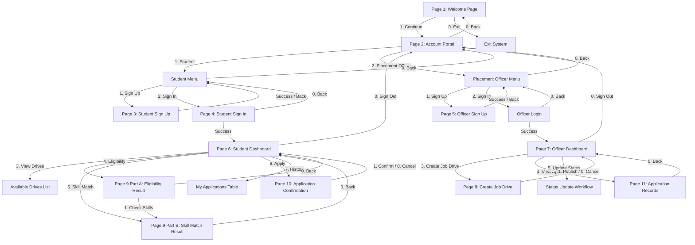

# 📘 NextStep — Demonstration & Operational User Manual

> **Course:** Programming in Java (25CSE0202) — Continuous Assessment (CA-3)  
> **Project:** NextStep — Campus Recruitment System  
> **Repository:** [https://github.com/raghavbansal9518-cloud/NextStep-Campus-Recruitment-System](https://github.com/raghavbansal9518-cloud/NextStep-Campus-Recruitment-System)  
> **Application Type:** Core Java Console Application + MySQL Database (JDBC)  
> **Author:** Raghav Bansal & Project Team

---

## 🎯 About This Manual

This manual is a practical, step-by-step guide designed for **live evaluation demonstrations, laboratory presentations, and project walkthroughs** with professors, evaluators, classmates, and teammates.

Keep this document open during your demo. It contains:
- Exact copy-ready sample data that matches database constraints.
- Step-by-step screen navigation covering Pages 1 through 11.
- Detailed explanations of all working application startup methods.
- A scripted 5-to-10 minute presentation sequence with spoken talking points.
- A pre-demonstration verification checklist.

---

## Table of Contents

1. [A. Before Starting — Setup & Verification](#a-before-starting--setup--verification)
2. [B. All Supported Ways to Start NextStep](#b-all-supported-ways-to-start-nextstep)
3. [C. Complete Application Navigation Guide (Pages 1–11)](#c-complete-application-navigation-guide-pages-111)
4. [D. Ready-to-Use Demonstration Data](#d-ready-to-use-demonstration-data)
5. [E. Placement Officer Activation Code Guide](#e-placement-officer-activation-code-guide)
6. [F. GitHub Collaboration Guide for Teammates](#f-github-collaboration-guide-for-teammates)
7. [G. Common Problems & Quick Fixes](#g-common-problems--quick-fixes)
8. [H. Suggested 5-to-10 Minute Live College Demo Script](#h-suggested-5-to-10-minute-live-college-demo-script)
9. [I. Final Pre-Demo Inspection Checklist](#i-final-pre-demo-inspection-checklist)

---

## A. Before Starting — Setup & Verification

Before launching NextStep for an evaluation or demo, ensure the following components are ready.

### One-Time Setup vs. Per-Session Actions

| Component | Frequency | What to Do |
| :--- | :---: | :--- |
| **Java JDK (17+)** | **One-time** | Install JDK 17, 21, or newer. Ensure `java -version` and `javac -version` output valid versions in your terminal. |
| **MySQL Server (8.0+)** | **One-time** | Install MySQL Community Server. Ensure the `MySQL80` Windows service is running. |
| **Database & Tables** | **One-time** | Run `database/schema.sql` and `database/sample_data.sql` to initialize `nextstep_db` and seed test companies and drives. |
| **Connector/J JAR** | **One-time** | Confirm that `lib/mysql-connector-j-8.4.0.jar` is present in the repository. |
| **`config/db.properties`** | **One-time** | Copy `config/db.properties.example` to `config/db.properties` and set your local MySQL password. |
| **Officer Activation Code** | **One-time** | Set `NEXTSTEP_OFFICER_ACTIVATION_CODE` via `setx` in Windows so officer registration works permanently. |
| **Application Launch** | **Per-session** | Double-click `run.bat` or run the PowerShell/CMD launch command whenever you present. |

---

## B. All Supported Ways to Start NextStep

NextStep supports four verified launch methods on Windows. Choose the method most convenient for your presentation environment.

```
+-------------------------------------------------------------------------------+
|                        HOW DO YOU WANT TO LAUNCH?                             |
+------------------------------------+------------------------------------------+
|  1. Fast Double-Click (GUI)        | Double-click run.bat in File Explorer    |
|  2. PowerShell (Automated)         | .\run.bat                                |
|  3. Command Prompt (Automated)     | run.bat                                  |
|  4. Manual Java Commands (Pure)    | javac -cp ... && java -cp ...            |
+------------------------------------+------------------------------------------+
```

---

### Method 1: Double-Click `run.bat` in File Explorer (Easiest)

- **Where:** Open File Explorer and navigate to the NextStep project root directory (where you cloned the repository).
- **Action:** Double-click the file named **`run.bat`**.
- **What happens:**
  1. A Command Prompt window opens automatically.
  2. The script switches to the project root directory (`%~dp0`).
  3. It verifies `javac`, `java`, `lib/mysql-connector-j-8.4.0.jar`, and `config/db.properties`.
  4. It compiles all Java source files into `bin/`.
  5. It launches `com.nextstep.Main`.
- **How to recognize success:** The Welcome Page banner appears with borders in cyan (`#6FC9FF`), options in slate (`#CAD5E5`), and the prompt `Enter your choice: ` in gold (`#E3B341`).
- **How to stop:** Enter `0` at the prompt to exit cleanly, or press `Ctrl + C`.

---

### Method 2: Running `.\run.bat` in Windows PowerShell

- **Where:** Open PowerShell inside the project root folder.
- **Command:**
  ```powershell
  .\run.bat
  ```
- **What happens:** PowerShell delegates to the Windows batch processor. Sources are re-compiled and NextStep starts interactively.
- **How to stop:** Enter `0` at any menu or press `Ctrl + C`.

---

### Method 3: Running `run.bat` in Command Prompt (CMD)

- **Where:** Open CMD inside the project root folder.
- **Command:**
  ```cmd
  run.bat
  ```
- **What happens:** Identical to Method 2. Runs the pre-flight checks, compiles bytecode to `bin/`, and starts the main application loop.

---

### Method 4: Manual Compilation & Execution (Evaluator Inspection)

If an evaluator asks to see raw command-line compilation without helper scripts:

#### In Windows PowerShell:
```powershell
# 1. Compile all source packages into bin/
javac -cp "lib/*;src" -d bin (Get-ChildItem -Path src -Recurse -Filter *.java | ForEach-Object { $_.FullName })

# 2. Run the application
java -cp "bin;lib/*" com.nextstep.Main
```

#### In Windows Command Prompt (CMD):
```cmd
:: 1. Compile source packages into bin/
javac -d bin -cp "lib\mysql-connector-j-8.4.0.jar" src\com\nextstep\model\*.java src\com\nextstep\database\*.java src\com\nextstep\dao\*.java src\com\nextstep\service\*.java src\com\nextstep\util\*.java src\com\nextstep\Main.java

:: 2. Run the application
java -cp "bin;lib\mysql-connector-j-8.4.0.jar" com.nextstep.Main
```

#### With JVM System Property for Activation Code (Per-Session Override):
```powershell
java -Dnextstep.officer.activation.code=CAMPUS_OFFICER_2026 -cp "bin;lib/*" com.nextstep.Main
```

---

## C. Complete Application Navigation Guide (Pages 1–11)

NextStep implements 11 designed console pages with 24-bit TrueColour ANSI borders, consistent 24-character fixed-width label columns, and input alignment at column 25.



---

### Page 1 — Welcome Page

- **Screen Header:** `NEXTSTEP | CAMPUS RECRUITMENT SYSTEM`
- **Purpose:** Entry portal and welcoming screen.
- **Available Options:**
  - `1. Continue` — Opens Page 2 (Account Portal).
  - `0. Exit` — Terminates the application with a friendly exit notice.
- **Input:** Single numeric digit (`1` or `0`). Invalid choices produce a warning notice.

---

### Page 2 — Account Portal (Role Selection)

- **Screen Header:** `NEXTSTEP | ACCOUNT PORTAL`
- **Purpose:** Role dispatching screen.
- **Available Options:**
  - `1. Student` — Dispatches to the Student workflow menu (Sign Up / Sign In).
  - `2. Placement Officer` — Dispatches to the Placement Officer workflow menu.
  - `0. Back` — Returns to Page 1 (Welcome Page).

---

### Page 3 — Student Sign Up

- **Screen Header:** `NEXTSTEP | STUDENT PORTAL — STUDENT SIGN UP`
- **Purpose:** Self-service registration for college students.
- **Input Fields (all aligned at column 25):**
  1. `Student ID:             ` (University Roll No / USN, e.g., `24BCE1001`)
  2. `Full Name:              ` (Student's full legal name)
  3. `Email:                  ` (Valid RFC-compliant email containing `@` and a domain)
  4. `Phone Number:           ` (10-digit mobile number)
  5. `Branch:                 ` (e.g., `Computer Science`, `Information Technology`)
  6. `CGPA:                   ` (Decimal between `0.00` and `10.00`)
  7. `Technical Skills:       ` (Comma-separated list, e.g., `Java, SQL, Git`)
  8. `Active Backlogs:        ` (Integer greater than or equal to zero)
  9. `Graduation Year:        ` (Integer between `2020` and `2035`)
  10. `Username:               ` (3 to 30 alphanumeric characters)
  11. `Password:               ` (Masked input, minimum 6 characters)
  12. `Confirm Password:       ` (Masked input, must match Password)
- **Form Navigation Shortcuts:**
  - Type `B` or `ESC` to return to the previous field and edit typos.
  - Type `N` or `TAB` to move forward retaining the existing entry.
  - Press `[Enter]` on any field that already has a value to confirm and keep it.
- **Footer Actions:**
  - `1. CREATE ACCOUNT` — Validates inputs, encrypts password via PBKDF2 with 16-byte random salt, and persists records atomically in MySQL (`users` and `students` tables).
  - `0. BACK` — Aborts account creation and returns safely to the Student Menu.

---

### Page 4 — Student Sign In

- **Screen Header:** `NEXTSTEP | STUDENT PORTAL — STUDENT SIGN IN`
- **Purpose:** Authenticates students before accessing the personal dashboard.
- **Input Fields:**
  1. `Student ID / Username:  ` (Accepts either the student's username or USN)
  2. `Password:               ` (Securely masked via `System.console().readPassword()`)
- **Actions:**
  - `1. SIGN IN` — Verifies PBKDF2 hash against `users` table, verifies role equals `STUDENT`, loads academic profile from `students`, and opens Page 6.
  - `0. BACK` — Returns to Student Menu.
- **Access Control:** Placement officer credentials entered here are rejected with a clear access denial notice (`Placement officer accounts cannot sign in here`).

---

### Page 5 — Placement Officer Sign Up

- **Screen Header:** `NEXTSTEP | PLACEMENT OFFICER PORTAL — OFFICER SIGN UP`
- **Purpose:** Authorized administrator onboarding.
- **Input Fields:**
  1. `Officer ID:             ` (Administrative employee code, e.g., `OFF-2026-01`)
  2. `Full Name:              ` (Officer's full name)
  3. `Official Email:         ` (Official campus email)
  4. `Username:               ` (Unique officer username)
  5. `Password:               ` (Masked password, min 6 characters)
  6. `Confirm Password:       ` (Masked confirmation)
  7. `Activation Code:        ` (Masked administrative secret)
- **Security Check:** The activation code must match `NEXTSTEP_OFFICER_ACTIVATION_CODE` or `-Dnextstep.officer.activation.code`. If unconfigured, registration is disabled. If incorrect, registration is rejected.
- **Actions:**
  - `1. CREATE ACCOUNT` — Persists officer user account with `PLACEMENT_OFFICER` role.
  - `0. BACK` — Returns to Placement Officer Menu.

---

### Page 6 — Student Dashboard

- **Screen Header:** `NEXTSTEP | STUDENT PORTAL — STUDENT DASHBOARD`
- **Welcome Line:** Displays student's full name and student USN from MySQL.
- **Available Options:**
  - `1. View Available Job Drives` — Displays open job openings sorted by CTC (highest first) and allows selecting a job to inspect eligibility and apply.
  - `2. Check Job Eligibility & Skill Match` — Prompts for Job ID and opens Page 9 (Unified Eligibility & Skill Match Analysis).
  - `3. Apply for an Eligible Job` — Prompts for Job ID and opens Page 10 (Application Confirmation) for eligible drives.
  - `4. View My Applications` — Displays table of student's own submitted applications with status.
  - `0. Sign Out` — Signs out of session and returns to Page 2 (Account Portal).

---

### Page 7 — Placement Officer Dashboard

- **Screen Header:** `NEXTSTEP | PLACEMENT OFFICER PORTAL — OFFICER DASHBOARD`
- **Welcome Line:** Confirms administrative session status.
- **Available Options:**
  - `1. Manage Student Records ` `[Coming Soon]` — Future milestone placeholder.
  - `2. Manage Companies ` `[Coming Soon]` — Future milestone placeholder.
  - `3. Create Job Drive` — Opens Page 8 (Create Job Drive).
  - `4. View Applications` — Opens Page 11 (Application Records).
  - `5. Update Application Status` — Prompts for Application ID and advances candidate status (`APPLIED` → `SHORTLISTED` → `SELECTED` / `REJECTED`).
  - `0. Sign Out` — Signs out and returns to Page 2 (Account Portal).

---

### Page 8 — Create Job Drive

- **Screen Header:** `NEXTSTEP | PLACEMENT OFFICER PORTAL — CREATE JOB DRIVE`
- **Live Company Lookup:** Queries MySQL and displays registered partner companies with their real IDs:
  ```text
  Available Partner Companies (Select by ID):
    [ID 1] Nexis Cloud Technologies       | Cloud Infrastructure   | Bengaluru, KA
    [ID 2] Apex Financial Software        | Fintech & Banking      | Mumbai, MH
    [ID 3] Quantum Robotics Labs          | AI & Robotics          | Hyderabad, TS
  ```
- **Input Fields:**
  1. `Company ID:             ` (Select an ID from the displayed partner list)
  2. `Job Title:              ` (e.g., `Associate Cloud Engineer`)
  3. `Job Description:        ` (e.g., `Design, build, and maintain cloud infrastructure on AWS and GCP.`)
  4. `CTC (LPA):              ` (Package in LPA, e.g., `12.50`)
  5. `Job Location:           ` (Job location, e.g., `Bengaluru, KA`)
  6. `Minimum CGPA:           ` (Cutoff, e.g., `7.20`)
  7. `Max Active Backlogs:    ` (Maximum allowed active backlogs, e.g., `0`)
  8. `Eligible Branches:      ` (Comma-separated, e.g., `Computer Science, Information Technology`)
  9. `Required Skills:        ` (Comma-separated, e.g., `Java, SQL, Linux, Git`)
  10. `Graduation Year:        ` (Target batch, e.g., `2026`)
- **Actions:**
  - `1. PUBLISH JOB` — Atomically inserts `jobs`, `job_eligible_branches`, and `job_required_skills` records into MySQL.
  - `0. CANCEL` — Aborts publishing without creating database records.

---

### Page 9 — Eligibility Result & Skill Match Result

#### Part A: Criteria Checklist (Eligibility Result)
- **Displays:** Student Name, Job ID, and a 5-point criteria checklist:
  - CGPA requirement vs Student status (`PASS` / `FAIL`)
  - Active Backlogs cutoff vs Student backlogs (`PASS` / `FAIL`)
  - Eligible branches list vs Student branch (`PASS` / `FAIL`)
  - Graduation Year cutoff vs Student year (`PASS` / `FAIL`)
  - Technical Skills requirement vs Student matched skills (`PASS` / `FAIL`)
- **Overall Result Banner:** `OVERALL RESULT: ELIGIBLE` (green) or `OVERALL RESULT: NOT ELIGIBLE` (red) — strictly derived from `RecruitmentService.checkEligibility()`.
- **Actions:**
  - `1. CHECK SKILL MATCH` — Transitions smoothly to Part B (detailed per-skill breakdown).
  - `2. APPLY FOR THIS JOB` — Offered only when overall eligible; allows immediate application without returning to dashboard.
  - `0. BACK` — Returns to previous page.

#### Part B: Skill Match Result
- **Displays:**
  - Table of required skills matched against student skills with `[MATCH]` (green) or `[MISSING]` (red).
  - Summary metrics: Matched Skills count (`3 / 4`), Skill Match percentage (`75%`), and missing skills list (`OOP`).
- **Actions:**
  - `1. APPLY FOR THIS JOB` — Offered when eligible.
  - `0. BACK` — Returns to Part A / caller.

---

### Page 10 — Application Confirmation

- **Screen Header:** `NEXTSTEP | APPLICATION PORTAL — APPLICATION CONFIRMATION`
- **Displays:** Student ID, Job ID, Job Role, dynamically calculated Eligibility (`ELIGIBLE`), and calculated Skill Match (`75%`).
- **Confirmation Prompt:** `Are you sure you want to apply?`
- **Actions:**
  - `1. CONFIRM APPLICATION` — Inserts application record with status `APPLIED` into `applications` table. Renders an official success confirmation with generated Application ID.
  - `0. CANCEL` — Aborts application without touching database.
- **Safety Guards:**
  - Rejects ineligible students automatically.
  - Gracefully catches and rejects duplicate applications via MySQL `uq_student_job` unique constraint.

---

### Page 11 — Application Records

- **Screen Header:** `NEXTSTEP | APPLICATION MANAGEMENT — APPLICATION RECORDS`
- **Security Check:** Restricts access strictly to authenticated Placement Officers.
- **Table Columns (57-char width):**
  ```text
  Application ID   Student ID    Student Name     Status
  ---------------------------------------------------------
  1                24BCE1001     Aarav Sharma     APPLIED
  2                24BCE1002     Diya Patel       SHORTLISTED
  ```
- **Actions:**
  - `1. VIEW DETAILS ` `[Coming Soon]` — Notifies user that detailed view is reserved for CAT-4.
  - `0. BACK` — Returns to Officer Dashboard.

---

## D. Ready-to-Use Demonstration Data

Use these prepared, copy-ready records during live evaluation presentations. All values strictly conform to database types, constraints, and validation regexes.

---

### 1. Student Registration Data (Passes All Validations)

```text
Student ID:             24BCE1050
Full Name:              Rohan V. Verma
Email:                  rohan.verma@campus.edu
Branch:                 Computer Science
CGPA:                   8.65
Graduation Year:        2026
Username:               rohan_verma
Password:               Campus@2026
Confirm Password:       Campus@2026
```

---

### 2. Placement Officer Registration Data

```text
Officer ID:             OFF-2026-08
Full Name:              Dr. Vikram Malhotra
Official Email:         vikram.malhotra@campus.edu
Username:               officer_vikram
Password:               Officer@Secure2026
Confirm Password:       Officer@Secure2026
Activation Code:        CAMPUS_OFFICER_2026
```
*(Ensure `CAMPUS_OFFICER_2026` matches your configured environment variable before presenting).*

---

### 3. Job Drive Creation Data (Page 8)

Use real Company ID `1` (`Nexis Cloud Technologies`) from the seeded database:

```text
Company ID:             1
Job Title:              Associate Cloud Engineer
Job Description:        Design, build, and maintain cloud infrastructure on AWS and GCP.
CTC (LPA):              12.50
Job Location:           Bengaluru, KA
Minimum CGPA:           7.20
Max Active Backlogs:    0
Eligible Branches:      Computer Science, Information Technology
Required Skills:        Java, SQL, Linux, Git
Graduation Year:        2026
```

---

### 4. Eligibility Demonstration: Pass vs. Fail Case

#### Case A: Eligible Student (PASS)
- **Student Profile:**
  - Branch: `Computer Science`
  - CGPA: `8.50`
  - Active Backlogs: `0`
  - Graduation Year: `2026`
- **Target Drive:** Job ID `1` (`Junior Backend Engineer` at Nexis Cloud)
  - Requires: Min CGPA `7.50`, Max Backlogs `0`, Branch `Computer Science` / `IT`, Year `2026`.
- **Expected Result on Page 9 Part A:** All criteria display `[PASS]`, and overall banner displays `OVERALL RESULT: ELIGIBLE` in green.

#### Case B: Ineligible Student (FAIL)
- **Student Profile:**
  - Branch: `Mechanical Engineering`
  - CGPA: `6.40`
  - Active Backlogs: `2`
  - Graduation Year: `2027`
- **Target Drive:** Job ID `1`
- **Expected Result on Page 9 Part A:**
  - CGPA (`6.40 < 7.50`): `[FAIL]`
  - Backlogs (`2 > 0`): `[FAIL]`
  - Branch (`Mechanical Engineering` not in `CSE, IT`): `[FAIL]`
  - Graduation Year (`2027 != 2026`): `[FAIL]`
  - Overall Banner displays `OVERALL RESULT: NOT ELIGIBLE` in red. Submission is blocked on Page 10.

---

### 5. Skill Match Demonstration (Page 9 Part B)

- **Job Required Skills:** `Java, SQL, OOP, Git` (Total: 4)
- **Student Skills:** `Java, SQL, Python, DSA, Git`
- **Calculated Result:**
  - Matched: `Java` [MATCH], `SQL` [MATCH], `Git` [MATCH] (3 matched)
  - Missing: `OOP` [MISSING] (1 missing)
  - Match Percentage: `Math.round((3 / 4) * 100) = 75%`

---

### 6. Application Lifecycle & Duplicate Prevention Demonstration

1. Sign in as student `rohan_verma`.
2. Choose Option `6. Apply for a Job` and input Job ID `1`.
3. Confirm submission on Page 10. Application ID (e.g., `85`) is generated with status `APPLIED`.
4. Immediately attempt to apply for Job ID `1` again.
5. **Expected Result:** The system safely rejects the duplicate submission with:
   `[ERROR] You have already submitted an application for this job drive.`
   No duplicate row is created in MySQL.

---

### 7. Status Advancement Demonstration (Placement Officer)

1. Sign out of student session and sign in as Placement Officer (`officer_vikram`).
2. Select Option `4. View Applications` to see the new application listed as `APPLIED`.
3. Select Option `5. Update Application Status`:
   - Enter Application ID: `<ID>`
   - Select New Status: `2. SHORTLISTED`
4. Re-open Option `4. View Applications` to verify the status has transitioned to `SHORTLISTED` in real time.

---

## E. Placement Officer Activation Code Guide

### What It Is & Why It Exists
The Activation Code is an **application-level onboarding safeguard**. Because NextStep is a multi-user campus application, random students must not be allowed to self-register as placement administrators.

> [!IMPORTANT]
> - The activation code is **NOT a MySQL password**.
> - It is **NOT stored in any database table**.
> - It is **NEVER hardcoded in Java source files**.
> - It is verified at runtime against a local system environment variable or JVM property.

---

### How to Configure on Windows (One-Time Setup)

#### Option 1: Via Windows Command Prompt (`cmd.exe`) — Recommended
Run this command once in CMD:
```cmd
setx NEXTSTEP_OFFICER_ACTIVATION_CODE "CAMPUS_OFFICER_2026"
```
> [!NOTE]
> `setx` writes the variable to your Windows User Registry. **Close and re-open your terminal** after running `setx` so the variable takes effect in all future sessions.

#### Option 2: Via Windows PowerShell
Run this command once in PowerShell:
```powershell
[System.Environment]::SetEnvironmentVariable('NEXTSTEP_OFFICER_ACTIVATION_CODE', 'CAMPUS_OFFICER_2026', 'User')
```
*(Restart terminal after executing).*

#### Option 3: Via Windows System Properties GUI
1. Press `Win + R`, type `sysdm.cpl`, and hit **Enter**.
2. Click the **Advanced** tab → **Environment Variables...**.
3. Under **User variables for <YourName>**, click **New...**.
4. Variable name: `NEXTSTEP_OFFICER_ACTIVATION_CODE`
5. Variable value: `CAMPUS_OFFICER_2026` (or any custom code you choose).
6. Click **OK** → **OK**.

---

## F. GitHub Collaboration Guide for Teammates

When sharing this project with classmates or collaborators, keep these practical points in mind:

### What Is Shared via GitHub vs. What Is Local

| Component | Shared on GitHub? | Notes |
| :--- | :---: | :--- |
| **Java Source Code (`src/`)** | **YES** | All models, DAOs, services, and `Main.java`. |
| **SQL Scripts (`database/`)** | **YES** | Schema and sample seed data. |
| **Connector/J JAR (`lib/`)** | **YES** | Official MySQL driver included. |
| **Launcher (`run.bat`)** | **YES** | One-click build script. |
| **Documentation (`README.md`, `docs/`)** | **YES** | Setup guides and manuals. |
| **Local MySQL Database** | **NO** | Each collaborator runs their own local MySQL server. |
| **Database Credentials (`config/db.properties`)** | **NO** | Ignored by `.gitignore` to prevent leaking passwords. |
| **Officer Activation Code** | **NO** | Configured locally by each developer. |

---

### Getting Started Steps for a New Collaborator

```cmd
:: 1. Clone the repository
git clone https://github.com/raghavbansal9518-cloud/NextStep-Campus-Recruitment-System.git
cd NextStep-Campus-Recruitment-System

:: 2. Configure local database credentials
copy config\db.properties.example config\db.properties
:: Open config\db.properties and set db.password=YOUR_MYSQL_PASSWORD

:: 3. Configure local officer activation code
setx NEXTSTEP_OFFICER_ACTIVATION_CODE "CAMPUS_OFFICER_2026"
:: (Restart terminal after running setx)

:: 4. Import MySQL schema and sample data
mysql -u root -p < database\schema.sql
mysql -u root -p < database\sample_data.sql

:: 5. Launch NextStep
run.bat
```

---

## G. Common Problems & Quick Fixes

### 1. `'javac'` or `'java'` is not recognized
- **Cause:** JDK is not installed or its `bin` folder is missing from the system `PATH`.
- **Fix:** Install JDK 17 or 21. Add `C:\Program Files\Java\jdk-21\bin` to your Windows Environment Variable `PATH`. Re-open terminal.

### 2. `run.bat` pauses with `[ERROR] MySQL Connector/J JDBC driver not found!`
- **Cause:** `lib/mysql-connector-j-8.4.0.jar` was accidentally deleted or moved.
- **Fix:** Restore the JAR from Git: `git checkout lib/mysql-connector-j-8.4.0.jar`.

### 3. Database connection fails (`Communications link failure`)
- **Cause:** The MySQL Windows service is stopped.
- **Fix:** Start the service in an Administrator PowerShell window:
  ```powershell
  Start-Service MySQL80
  # Or via CMD:
  net start MySQL80
  ```

### 4. `Access denied for user 'root'@'localhost'`
- **Cause:** The password in `config/db.properties` does not match your local MySQL root password.
- **Fix:** Open `config/db.properties` and correct the `db.password` property.

### 5. Officer Registration disabled: `No activation code has been configured`
- **Cause:** Neither `NEXTSTEP_OFFICER_ACTIVATION_CODE` nor `-Dnextstep.officer.activation.code` was found.
- **Fix:** Run `setx NEXTSTEP_OFFICER_ACTIVATION_CODE "CAMPUS_OFFICER_2026"` in CMD, close all terminal windows, open a fresh terminal, and relaunch.

### 6. Terminal Password Input appears to "freeze"
- **Cause:** Normal Java `System.console().readPassword()` behaviour. It silences character echo completely at the OS level so no characters or shoulder-surfing leaks occur.
- **Fix:** Simply type the password and press **Enter**. Keystrokes are captured correctly.

---

## H. Suggested 5-to-10 Minute Live College Demo Script

Use this proven sequence when presenting NextStep to evaluators.

```
+-------------------------------------------------------------------------------+
|                      5-TO-10 MINUTE DEMO TIMELINE                             |
|                                                                               |
|  [0:00 - 1:00]  Architecture & Launcher (`run.bat`)                           |
|  [1:00 - 2:30]  Student Self-Registration & Security (Page 3)                 |
|  [2:30 - 4:00]  Automated Eligibility & Skill Analysis (Pages 6 & 9)           |
|  [4:00 - 5:30]  Job Application & Duplicate Guard (Page 10)                   |
|  [5:30 - 7:30]  Officer Operations & Live Status Advancement (Pages 7 & 11)   |
|  [7:30 - 9:00]  Summary & Code Architecture (Lambdas, Streams, JDBC)          |
+-------------------------------------------------------------------------------+
```

---

### Step-by-Step Presentation Script

#### 1. Architecture & Startup (Minute 0:00 - 1:00)
- **Action:** Open terminal and run `.\run.bat`.
- **Spoken Talking Point:**
  > *"Good morning/afternoon, professors. Today I am presenting **NextStep**, a console-based Campus Recruitment System built in Java and MySQL. The system uses a clean layered architecture—separating Domain Models, Data Access Objects, and Service logic. I'm launching the application using our Windows build script, which verifies the JDK and JDBC driver before launching the JVM."*

#### 2. Welcome Page & Student Sign Up (Minute 1:00 - 2:30)
- **Action:** Select `1. Continue` → `1. Student` → `1. Student Registration`.
- **Action:** Enter demo student data (`24BCE1050`, `Rohan V. Verma`, etc.).
- **Spoken Talking Point:**
  > *"Here on Page 3 is the Student Sign Up screen. Notice the consistent 24-character fixed label column and aligned value input. If the user makes a typo, our form navigation shortcuts allow pressing 'B' or 'ESC' to return to previous fields without losing data. On submission, the password is encrypted using PBKDF2 with HMAC-SHA256 and a 16-byte cryptographic salt."*

#### 3. Student Dashboard & Automated Eligibility (Minute 2:30 - 4:00)
- **Action:** Sign in on Page 4 and reach Page 6 (Student Dashboard).
- **Action:** Select Option `4. Check Job Eligibility` and enter Job ID `1`.
- **Spoken Talking Point:**
  > *"On Page 6, the dashboard displays personal academic information loaded from MySQL. When we check job eligibility for Job ID 1, our automated Eligibility Engine compares student CGPA, backlogs, branch, and graduation year against the drive requirements. Next, selecting Option 1 transitions to our Skill Match analysis, which computes real-time skill alignment percentage."*

#### 4. Job Application & Duplicate Guard (Minute 4:00 - 5:30)
- **Action:** Select Option `6. Apply for a Job` → enter Job ID `1` → Option `1. CONFIRM APPLICATION`.
- **Action:** Re-attempt applying for Job ID `1` to demonstrate duplicate prevention.
- **Spoken Talking Point:**
  > *"Page 10 presents a final confirmation screen. When confirmed, an application record is created with initial status 'APPLIED'. If the student tries applying again, the application catches the unique constraint violation at both the service layer and database schema level, preventing duplicate entries."*

#### 5. Placement Officer Operations & Status Lifecycle (Minute 5:30 - 7:30)
- **Action:** Sign out (`0`), select `2. Placement Officer` → sign in as Officer.
- **Action:** Open Option `4. View Applications` (Page 11) to see the application.
- **Action:** Select Option `5. Update Application Status` → advance to `SHORTLISTED`.
- **Spoken Talking Point:**
  > *"Signing into the Placement Officer portal requires role verification. On Page 11, the officer views all applicant records with their roll numbers and statuses. When the officer advances candidate Rohan to 'SHORTLISTED', the status updates in MySQL immediately and is reflected on the student's next login."*

#### 6. Summary & Viva Q&A Ready (Minute 7:30 - 9:00)
- **Spoken Talking Point:**
  > *"To summarize: NextStep enforces role-based access control, transaction atomicity, automated academic evaluation, and cryptographic security using only standard Core Java SE and JDBC, with no heavy third-party web frameworks. Thank you, and I am ready for any questions."*

---

## I. Final Pre-Demo Inspection Checklist

Print or review this 10-point checklist before your evaluation begins:

- [ ] **1. MySQL Service:** Active and responding (`net start MySQL80`).
- [ ] **2. Database Created:** `USE nextstep_db; SHOW TABLES;` displays 8 tables.
- [ ] **3. Seed Data Intact:** `SELECT COUNT(*) FROM companies;` returns `3`.
- [ ] **4. Database Credentials:** `config/db.properties` has correct root password.
- [ ] **5. Connector/J Driver:** `lib/mysql-connector-j-8.4.0.jar` present.
- [ ] **6. Activation Code Configured:** `NEXTSTEP_OFFICER_ACTIVATION_CODE` set in Windows.
- [ ] **7. Launcher Verified:** `run.bat` opens Welcome Page without errors.
- [ ] **8. Sample Student Data Ready:** Copied to a scratch notepad for quick paste.
- [ ] **9. Partner Company ID Known:** Company ID `1` (`Nexis Cloud Technologies`).
- [ ] **10. Terminal Maximized:** Terminal window sized to at least 80x25 characters for optimal TrueColour layout display.
