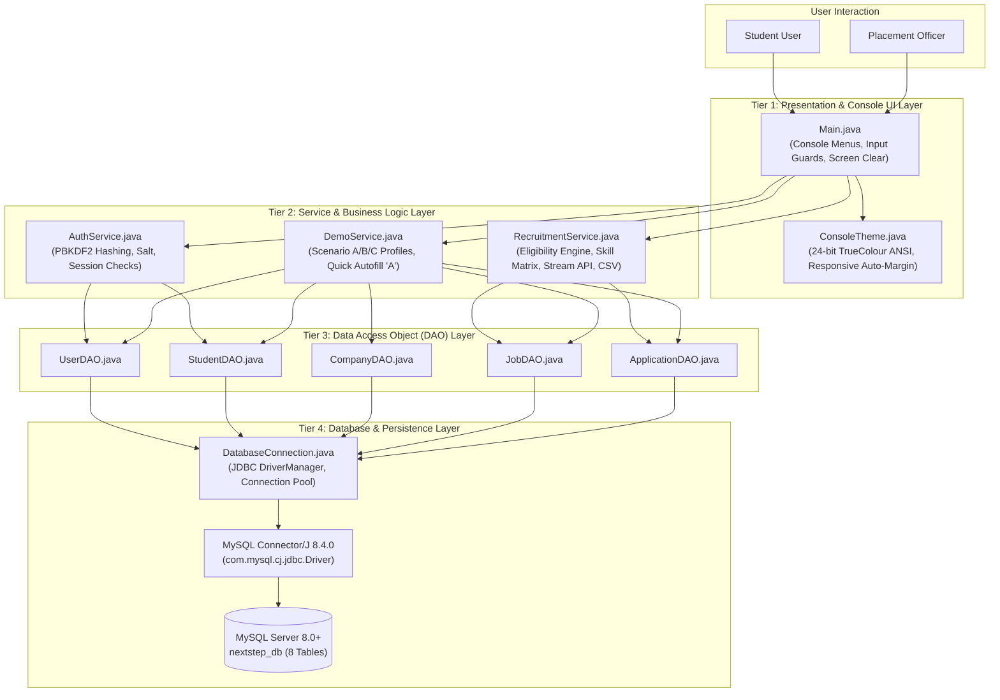
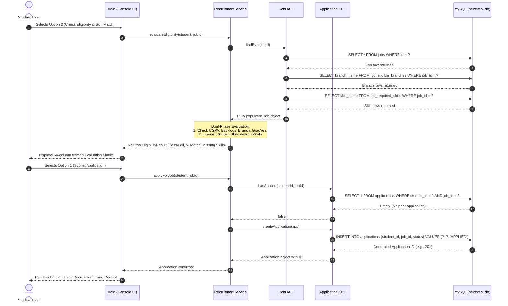

# NextStep — Technical System Architecture & Layered Design

---

## 1. Architectural Philosophy & Overview

NextStep is built upon a **Classic 4-Tier Layered Architecture** coupled with the **Data Access Object (DAO) Design Pattern**.

### Honest Architectural Classification
In academic presentations, console applications are sometimes mistakenly labelled as full "Model-View-Controller (MVC)". To be technically precise:
- **Model:** Strictly implemented in `com.nextstep.model` (Plain Old Java Objects / POJOs).
- **Service Layer:** Strictly implemented in `com.nextstep.service` (Business logic, calculations, transactions).
- **DAO Layer:** Strictly implemented in `com.nextstep.dao` (Database abstraction and SQL execution).
- **Presentation Layer:** In a console-driven Java application without GUI frameworks, the View (rendering text to terminal) and Controller (reading keyboard input and dispatching actions) are consolidated inside [`Main.java`](file:///c:/Semister-3/Programming%20in%20Java/JavaProjects/NextStep-Campus-Recruitment-System/src/com/nextstep/Main.java) and [`ConsoleTheme.java`](file:///c:/Semister-3/Programming%20in%20Java/JavaProjects/NextStep-Campus-Recruitment-System/src/com/nextstep/util/ConsoleTheme.java).

Therefore, NextStep is authentically classified as a **4-Tier Layered Architecture with DAO Pattern** rather than pure decoupled MVC.

---

## 2. High-Level Architecture Diagram



---

## 3. Package Structure & Responsibilities

The codebase resides in `src/com/nextstep/` organized into six cohesive packages:

```
src/com/nextstep/
├── Main.java                          # Top-level Application Entry Point & UI Coordinator
│
├── model/                             # Tier 0: Domain Entities & Data Transfer Objects (POJOs)
│   ├── Role.java                      # Enum: STUDENT, PLACEMENT_OFFICER
│   ├── ApplicationStatus.java         # Enum: APPLIED, SHORTLISTED, SELECTED, REJECTED
│   ├── User.java                      # Base Authentication Entity
│   ├── Student.java                   # Student Profile Entity (Extends Domain Context)
│   ├── Company.java                   # Hiring Partner Entity
│   ├── Job.java                       # Job Drive Specification Entity
│   └── Application.java               # Placement Filing & Status Entity
│
├── database/                          # Tier 4: Database Infrastructure
│   └── DatabaseConnection.java        # JDBC Driver Loader & Connection Provider
│
├── dao/                               # Tier 3: Data Access Objects (CRUD & SQL)
│   ├── UserDAO.java                   # User Account Persistence & Lookup
│   ├── StudentDAO.java                # Student Record & Skill Set Persistence
│   ├── CompanyDAO.java                # Partner Company Retrieval
│   ├── JobDAO.java                    # Job Postings, Eligible Branches & Skills
│   └── ApplicationDAO.java            # Application Filing, Retrieval & Updates
│
├── service/                           # Tier 2: Business Logic & Rules Engine
│   ├── AuthService.java               # Authentication, Salted PBKDF2 Hashing
│   ├── RecruitmentService.java        # Eligibility Engine, Skill Matcher, Streams, CSV
│   └── DemoService.java               # Demo Profiles (A, B, C) & Repeatable Demo Setup
│
└── util/                              # Cross-Cutting Utilities
    ├── ConsoleTheme.java              # 24-bit TrueColour Theme & Auto-Margin Stream
    ├── ValidationUtil.java            # Form Validation, Email Regex, Range Guards
    ├── PresentationConfig.java        # Dynamic UI Visibility & Presentation Toggles
    └── Result.java                    # Generic Success/Failure Wrapper (Result<T>)
```

---

## 4. Layer-by-Layer Detailed Analysis

### Layer 1: Presentation Layer (`Main.java`, `ConsoleTheme.java`)
- **Responsibility:** Captures user keystrokes from `System.in`, cleans inputs, invokes appropriate service methods, renders styled terminal tables, and handles navigation.
- **Key Characteristics:**
  - Standardized **64-column framed box design** (`FRAME_WIDTH = 64`).
  - TrueColour ANSI rendering (Cyan `#6FC9FF`, Gold `#E3B341`, Slate `#CAD5E5`, Green `#56D364`, Red `#F85149`).
  - **Responsive Auto-Margin Engine:** Automatically calculates $(W - 64) / 2$ spaces where $W$ is the console column width (e.g., 28 spaces on a 120-column terminal), rendering all screens centered horizontally.
  - Centralized input reading via `readConsoleLine(Scanner)` to ensure smooth terminal flow and eliminate stream races after screen clears.

### Layer 2: Service Layer (`AuthService`, `RecruitmentService`, `DemoService`)
- **Responsibility:** Executes all business rules, calculations, and security algorithms. It has **zero awareness of console printing or terminal formatting**.
- **Key Characteristics:**
  - `AuthService`: Generates 16-byte random salts via `SecureRandom`, computes PBKDF2 keys over 10,000 iterations, and coordinates database transaction commits/rollbacks.
  - `RecruitmentService`: Contains the dual-phase eligibility engine. Evaluates academic cutoffs, executes set-theoretic intersection for skill matching, utilizes Java 8 Stream API for statistics (`groupingBy`, `partitioningBy`), and writes RFC-4180 CSV files.
  - `DemoService`: Manages 3 centralized student profiles, an officer profile, and a demo company, guaranteeing repeatable live evaluations.

### Layer 3: Data Access Object (DAO) Layer (`*DAO.java`)
- **Responsibility:** Acts as the abstraction boundary between Java objects and MySQL SQL queries.
- **Key Characteristics:**
  - **No Business Logic:** A DAO only performs Create, Read, Update, Delete (CRUD) operations.
  - **100% PreparedStatements:** Every SQL statement uses parameter placeholders (`?`), completely eliminating SQL Injection vulnerabilities.
  - **Safe Resource Cleanup:** All database handles (`Connection`, `PreparedStatement`, `ResultSet`) are enclosed inside `try-with-resources` blocks to prevent connection leaks.
  - **Object Relational Mapping (Manual):** Maps relational SQL rows from `ResultSet` into strongly typed Java model instances (`Student`, `Job`, `Application`).

### Layer 4: Database Layer (`DatabaseConnection`, MySQL)
- **Responsibility:** Manages physical TCP/IP socket connections to the local MySQL server and executes InnoDB table operations.
- **Key Characteristics:**
  - Connection parameters (`db.url`, `db.user`, `db.password`) are decoupled into `config/db.properties`.
  - Enforces database-level constraints: foreign key cascades, unique roll numbers, unique usernames, and composite uniqueness preventing duplicate applications.

---

## 5. End-to-End Execution Sequence Diagram

The following sequence illustrates the complete flow when a Student evaluates eligibility and applies for an opening:



---

## 6. Design Patterns Implemented

| Design Pattern | Where Implemented | Why It Was Chosen |
|---|---|---|
| **Data Access Object (DAO)** | `UserDAO`, `StudentDAO`, `JobDAO`, `CompanyDAO`, `ApplicationDAO` | Decouples SQL database queries from business logic. Allows changing SQL without breaking business services. |
| **Service Layer Pattern** | `AuthService`, `RecruitmentService`, `DemoService` | Centralizes core business rules, algorithms, and transactions away from the UI. |
| **Data Transfer Object (DTO)** | `com.nextstep.model.*` (`Student`, `Job`, etc.) | Encapsulates multiple fields into single strongly typed objects passed between layers. |
| **Singleton / Static Factory** | `DatabaseConnection.getConnection()` | Provides centralized connection management and configuration loading. |
| **Strategy / Parameter Object** | `RecruitmentService.EligibilityResult` | Encapsulates complex multi-criteria evaluation results into an immutable payload. |
| **Filter / Decorator Stream** | `ConsoleTheme.AutoMarginOutputStream` | Dynamically wraps `System.out` to inject responsive left-margin spaces transparently. |
