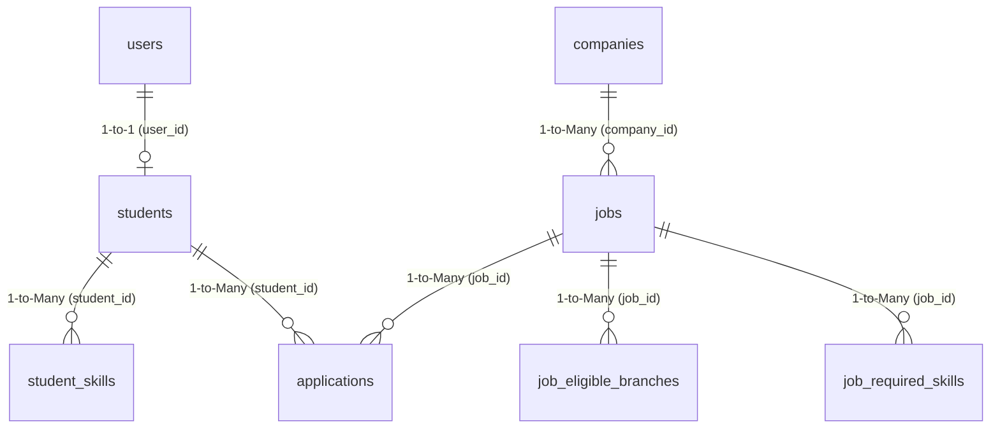

# NextStep — Campus Recruitment System
## Semester 3 Viva Voce & CA-3 Oral Examination Preparation Guide
**Course:** Programming in Java (25CSE0202)  
**Project:** NextStep — Campus Recruitment System  
**Audience:** Undergraduate Computer Science Students preparing for oral defense and practical viva.

---

## 1. Project Overview & Problem Statement

### What is NextStep?
NextStep is an enterprise-grade, console-based Java application designed to automate campus placement workflows. It bridges the gap between graduating students, partner companies, and campus placement administrators.

### Problem Statement
Traditional college placement management suffers from:
1. **Manual Inefficiencies:** Tracking hundreds of applicants across multiple corporate recruitment drives using paper forms or detached spreadsheets leads to human error.
2. **Inconsistent Eligibility Checks:** Manually verifying academic cutoffs (CGPA cutoffs, maximum active backlogs, eligible degree branches, and required technical skills) is time-consuming and error-prone.
3. **Duplicate Applications:** Without system-level constraints, students frequently apply multiple times to the same role.
4. **Security Vulnerabilities:** Storing student passwords in plaintext or unhashed formats exposes sensitive student data.
5. **Lack of Lifecycle Traceability:** Placement cells lack centralized mechanisms to transition candidate applications through recruitment stages (`APPLIED` → `SHORTLISTED` → `SELECTED` / `REJECTED`) and export validated reports for accreditation audits.

### NextStep Solution
NextStep solves these challenges by combining:
- **Relational Integrity:** 8 normalized MySQL tables with foreign key cascades and unique constraints.
- **Automated Eligibility Engine:** Programmatic validation of student credentials before permitting job applications.
- **Cryptographic Security:** Salted PBKDF2 with HMAC-SHA256 password hashing.
- **Role-Based Access Control (RBAC):** Strict separation of privileges between `STUDENT` and `PLACEMENT_OFFICER`.
- **Modern Java Concepts:** Lambdas, Streams, Collectors, Generics, and try-with-resources File I/O.

---

## 2. System Architecture & Layered Design

NextStep follows a clean **Layered Architecture (Separation of Concerns)**:

```text
┌─────────────────────────────────────────────────────────────┐
│                 PRESENTATION LAYER (Console UI)              │
│       Main.java (Menus, Scanner Input Guards, Role Dispatch)│
└──────────────────────────────┬──────────────────────────────┘
                               │ Calls
┌──────────────────────────────▼──────────────────────────────┐
│                   SERVICE LAYER (Business Logic)             │
│   AuthService.java           RecruitmentService.java        │
│   - PBKDF2 Password Hashing  - Eligibility Evaluation Engine│
│   - Registration Transaction - Streams, Lambdas, Collectors │
│   - Credential Authentication- CSV Export & Audit Archival  │
└──────────────────────────────┬──────────────────────────────┘
                               │ Calls
┌──────────────────────────────▼──────────────────────────────┐
│               DATA ACCESS LAYER (DAO Pattern)               │
│   UserDAO       StudentDAO     CompanyDAO  JobDAO   AppDAO  │
│   - PreparedStatements       - Parameterized Queries        │
│   - Transaction Support      - ResultMapping to POJOs       │
└──────────────────────────────┬──────────────────────────────┘
                               │ Connects via JDBC
┌──────────────────────────────▼──────────────────────────────┐
│                    DATABASE LAYER (MySQL 8.0)                │
│    nextstep_db (8 Normalized Relational Tables & Indexes)    │
└─────────────────────────────────────────────────────────────┘
```

### Why Layered Architecture?
1. **Maintainability:** Modifying SQL queries in a DAO does not break the presentation or business layer.
2. **Reusability:** Business methods (e.g. `checkEligibility` or `getJobsSortedByCtc`) can be tested independently of console menus.
3. **Security:** Direct database access is restricted to the DAO layer; presentation components never construct raw SQL.

---

## 3. Object-Oriented Programming (OOP) Concepts

| Concept | Definition | How Implemented in NextStep |
| :--- | :--- | :--- |
| **Encapsulation** | Bundling data (fields) and methods that operate on that data while restricting direct external access. | All model classes ([`User`](../src/com/nextstep/model/User.java), [`Student`](../src/com/nextstep/model/Student.java), [`Job`](../src/com/nextstep/model/Job.java), [`Application`](../src/com/nextstep/model/Application.java)) have `private` fields and expose access through `public` getters, setters, and constructors. |
| **Data Hiding & Validation** | Preventing unauthorized or invalid state changes. | Getters return immutable views (e.g. `Collections.unmodifiableList(reasons)` in `EligibilityResult`) or defensive copies. Input validation guards in [`ValidationUtil`](../src/com/nextstep/util/ValidationUtil.java) prevent invalid data from entering domain models. |
| **Type Safety via Enums** | Defining a fixed set of constants to eliminate magic strings and invalid states. | [`Role`](../src/com/nextstep/model/Role.java) (`STUDENT`, `PLACEMENT_OFFICER`) and [`ApplicationStatus`](../src/com/nextstep/model/ApplicationStatus.java) (`APPLIED`, `SHORTLISTED`, `SELECTED`, `REJECTED`) prevent runtime invalid value assignments. |
| **Separation of Responsibilities** | Single Responsibility Principle (SRP). | POJOs store state; DAOs handle persistence; Services handle business rules; `Main` handles user interaction. |

---

## 4. Classes & Their Core Responsibilities

### 1. Presentation & Configuration
- **`com.nextstep.Main`**: Application entry point. Houses the console menus, role-based session routing, one-click demo autofill, input sanitization helpers (`readInt`, `readDouble`, `readNonEmptyString`), and first-run officer provisioning prompt. Supports Constructor Dependency Injection (`Main(Scanner, AuthService, RecruitmentService, UserDAO, StudentDAO, CompanyDAO, JobDAO, ApplicationDAO)`), enabling isolated testing and mock DAO injection.
- **`com.nextstep.util.PresentationConfig`**: Central configuration flag toggle for academic presentations (enables/disables specific menu choices without code edits).

### 2. Service Layer (Business Rules)
- **`com.nextstep.service.AuthService`**: Handles user authentication, cryptographic salt generation, PBKDF2 password derivation, and multi-table transactional registration.
- **`com.nextstep.service.RecruitmentService`**: The core recruitment engine. Evaluates academic/skill eligibility, manages application submissions, enforces RBAC checks, executes Java Streams and Collectors, and handles CSV export/archival.

### 3. Data Access Layer (DAOs)
- **`com.nextstep.dao.UserDAO`**: Queries and persists records in `users`. Implements `existsByUsername(username)` and `existsByEmail(email)` querying the unique indexes in MySQL for safe duplicate checking.
- **`com.nextstep.dao.StudentDAO`**: Persists records in `students`, verifies `existsByStudentId(studentId)`, and manages normalized student skills in `student_skills`.
- **`com.nextstep.dao.CompanyDAO`**: Read queries for partner companies in `companies` (`findAllCompanies()`, `findCompanyById()`).
- **`com.nextstep.dao.JobDAO`**: Queries and persists job openings in `jobs`, persisting 10 critical parameters (role, description, CTC, location, min CGPA, max backlogs, batch) and populating eligible branches and required skills via normalized relational tables and JOINs.
- **`com.nextstep.dao.ApplicationDAO`**: Manages recruitment applications in `applications`, handles status updates, joins applicant metadata, and traps duplicate submissions.

### 4. Utilities
- **`com.nextstep.database.DatabaseConnection`**: Central connection provider. Reads credentials from `config/db.properties` using `java.util.Properties`.
- **`com.nextstep.util.Result<T>`**: Generic container for wrapping operation success payloads or error messages.
- **`com.nextstep.util.ValidationUtil`**: Lightweight validators for emails, usernames, CGPA, backlogs, and generic list pagination (`paginate<T>`).

---

## 5. Collections & Generics (Lectures 47–48)

### Collections Used:
1. **`List<T>` / `ArrayList<T>`**:
   - Used for dynamic collections of jobs, applications, companies, and skills.
   - Example: `List<Application> apps = new ArrayList<>();`
2. **`Map<K, V>`**:
   - Used by Collectors to group recruitment statistics.
   - `Map<ApplicationStatus, Long>` for recruitment summaries.
   - `Map<Boolean, Long>` for placement partition counts.

### Generics Implemented:
1. **Generic Container Class (`Result<T>`):**
   ```java
   public class Result<T> {
       private final boolean success;
       private final T data;
       private final String message;
       // Provides type-safe return payload without object casting
   }
   ```
2. **Generic Method (`ValidationUtil.paginate`):**
   ```java
   public static <T> List<T> paginate(List<T> list, int page, int pageSize) {
       if (list == null || list.isEmpty() || page < 1 || pageSize < 1) {
           return Collections.emptyList();
       }
       int fromIndex = (page - 1) * pageSize;
       if (fromIndex >= list.size()) {
           return Collections.emptyList();
       }
       int toIndex = Math.min(fromIndex + pageSize, list.size());
       return list.subList(fromIndex, toIndex);
   }
   ```
   **Viva Explanation:** Generic parameter `<T>` enables the method to paginate any collection (`List<Job>`, `List<Application>`, `List<String>`) in a type-safe manner without duplicating logic.

---

## 6. Exception Handling (Lectures 25–28)

NextStep deliberately employs both **Checked** and **Unchecked** exceptions:

| Exception Type | Class | Why Used in NextStep |
| :--- | :--- | :--- |
| **Checked Exception** | `java.sql.SQLException` | Forces caller methods to explicitly handle database connectivity, syntax, or constraint issues. |
| **Checked Exception** | `java.io.IOException` | Handled during file operations (`FileReader`, `FileWriter`, `BufferedReader`, `BufferedWriter`). |
| **Unchecked Exception** | `IllegalArgumentException` | Thrown when invalid parameters are supplied (e.g. negative backlogs, out-of-range CGPA, invalid email). |
| **Unchecked Exception** | `IllegalStateException` | Thrown when business logic preconditions fail (e.g. student already applied for this job, or job is closed). |
| **Unchecked Exception** | `SecurityException` | Thrown when an unauthorized user attempts an operation restricted to placement administrators. |

### Try-With-Resources (Automatic Resource Management):
Introduced in Java 7 (`AutoCloseable` interface), NextStep uses try-with-resources across all database calls and file handlers:
```java
try (Connection conn = DatabaseConnection.getConnection();
     PreparedStatement stmt = conn.prepareStatement(sql)) {
    // Both conn and stmt are guaranteed to close even if an exception occurs
}
```
**Viva Benefit:** Eliminates manual `finally { rs.close(); stmt.close(); conn.close(); }` boilerplate and prevents connection leaks.

---

## 7. JDBC & PreparedStatement (Lectures 35–42)

### 1. Driver Registration & Loading:
The MySQL driver is registered in a static initializer block in `DatabaseConnection`:
```java
Class.forName("com.mysql.cj.jdbc.Driver");
```

### 2. PreparedStatement vs. Statement:
- **Regular `Statement`:** Directly executes string-concatenated SQL queries. Highly vulnerable to SQL Injection attacks (e.g. `' OR '1'='1`).
- **`PreparedStatement`:** SQL statements are pre-compiled by the database engine. User input is supplied via placeholder question marks (`?`):
  ```java
  String sql = "SELECT * FROM users WHERE username = ? AND password_hash = ?";
  PreparedStatement stmt = conn.prepareStatement(sql);
  stmt.setString(1, username);
  ```
  **Viva Explanation:** In a `PreparedStatement`, user input is treated strictly as data/literals, never as executable SQL code.

### 3. ACID Transactions (`commit()` and `rollback()`):
In student registration, a single logical unit of work inserts records into 3 tables (`users`, `students`, `student_skills`):
```java
conn.setAutoCommit(false); // Begin Transaction
try {
    userDAO.createUser(conn, user);
    studentDAO.createStudent(conn, student);
    studentDAO.saveStudentSkills(conn, student.getId(), skills);
    conn.commit();         // All succeeded: persist changes atomically
} catch (Exception e) {
    conn.rollback();       // Any failure: revert all operations
    throw new SQLException("Registration failed", e);
} finally {
    conn.setAutoCommit(true);
}
```
**Viva Explanation:** Ensures **Atomicity** (all operations succeed or none do), preventing orphan user records without corresponding student profiles.

---

## 8. Database Normalization & Relationships

NextStep database (`nextstep_db`) contains **8 normalized relational tables**:



### Key Relational Constraints:
1. **1-to-1 (`users` ↔ `students`):** `students.user_id` has a `UNIQUE` index and foreign key reference with `ON DELETE CASCADE`.
2. **1-to-Many (`jobs` ↔ `job_required_skills`):** Normalizes multiple skills required for a job into separate rows with composite unique key `(job_id, skill_name)` (1NF & 2NF).
3. **Composite Unique Index on `applications`:**
   ```sql
   UNIQUE KEY uq_student_job (student_id, job_id)
   ```
   **Viva Explanation:** Prevents duplicate applications directly at the database engine level. If an application duplicate is attempted, MySQL throws Error Code `1062`, which NextStep catches gracefully.

---

## 9. Lambda Expressions & Stream API (Lectures 43–46)

### 1. Lambda Expressions (Lectures 43–44):
Used for concise implementations of functional interfaces (`Comparator<T>`, `Predicate<T>`).
- **Example in `RecruitmentService.getJobsSortedByCtc`:**
  ```java
  jobs.sort((j1, j2) -> {
      if (j1.getCtcLpa() == null) return 1;
      if (j2.getCtcLpa() == null) return -1;
      return j2.getCtcLpa().compareTo(j1.getCtcLpa()); // Descending package sort
  });
  ```

### 2. Stream Pipelines (Lectures 45–46):
Streams allow functional, declarative processing of collections.
- **Example: Retrieving unique hiring company names sorted alphabetically:**
  ```java
  List<String> hiringCompanies = jobDAO.findAllJobs().stream()
      .filter(j -> "OPEN".equalsIgnoreCase(j.getStatus()))  // Filter active jobs
      .map(Job::getCompanyName)                           // Transform Job to String
      .distinct()                                          // Remove duplicates
      .sorted()                                            // Natural alphabetical sort
      .collect(Collectors.toList());                       // Terminal operation
  ```
- **Stream Terminal Operations:**
  - `.count()`: Returns the total number of open placement drives.
  - `.anyMatch()`: Checks whether any open job exists in a specified city.

---

## 10. Collectors API (Lectures 45–46)

Used in recruitment analytics to partition and summarize candidate applications:

### 1. `Collectors.groupingBy()` with `Collectors.counting()`:
Groups applications by recruitment lifecycle stage:
```java
Map<ApplicationStatus, Long> summary = applications.stream()
    .collect(Collectors.groupingBy(Application::getStatus, Collectors.counting()));
```
Produces a breakdown: `{APPLIED=15, SHORTLISTED=6, SELECTED=2, REJECTED=3}`.

### 2. `Collectors.partitioningBy()` with `Collectors.counting()`:
Partitions applications into two groups based on a boolean predicate (Placed vs In-Progress):
```java
Map<Boolean, Long> placementStats = applications.stream()
    .collect(Collectors.partitioningBy(
        app -> app.getStatus() == ApplicationStatus.SELECTED,
        Collectors.counting()
    ));
```
Produces: `{true=2, false=22}` (2 placed, 22 in-progress).

---

## 11. File Handling & CSV Processing (Lectures 49–54)

### 1. CSV Report Export (`exportApplicationsToCsv`):
- Uses `BufferedWriter` and `FileWriter` wrapped in try-with-resources.
- Writes schema header and iterates through applications.
- Adheres to **RFC-4180 CSV standard**: fields containing commas or quotes are wrapped in double quotes, and internal quotes are escaped as `""` via `escapeCsvField()`.

### 2. CSV Ingestion & Auditing (`processAndArchiveCsvReport`):
- Reads exported CSV using `BufferedReader` and `FileReader`.
- Validates the CSV header to ensure expected schema.
- Custom token parser `parseCsvLine()` handles embedded commas inside quotes without breaking tokens.
- Loads records into `ArrayList<Application>`.
- Allows placement officers to search and update applicant statuses in memory.
- Writes audited records with a `Verification Status` tag to a separate destination file (`reports/applications_audited.csv`).

---

## 12. Key Methods Worth Demonstrating in Viva

| Method | Class | What to Explain to Evaluator |
| :--- | :--- | :--- |
| **`checkEligibility()`** | [`RecruitmentService`](../src/com/nextstep/service/RecruitmentService.java#L102-L178) | Demonstrates programmatic evaluation: checks student CGPA cutoff, backlog count, branch eligibility, and performs set intersection on required technical skills. |
| **`registerStudent()`** | [`AuthService`](../src/com/nextstep/service/AuthService.java#L116-L201) | Demonstrates ACID database transaction (`conn.setAutoCommit(false)`), PBKDF2 password derivation, and multi-table rollback on failure. |
| **`getJobsSortedByCtc()`** | [`RecruitmentService`](../src/com/nextstep/service/RecruitmentService.java#L297-L306) | Demonstrates Lambda expressions in `Comparator<Job>` sorting `BigDecimal` CTC packages. |
| **`getDistinctHiringCompanies()`** | [`RecruitmentService`](../src/com/nextstep/service/RecruitmentService.java#L315-L322) | Demonstrates full Stream pipeline: `.filter()` → `.map()` → `.distinct()` → `.sorted()` → `.collect()`. |
| **`getRecruitmentSummary()`** | [`RecruitmentService`](../src/com/nextstep/service/RecruitmentService.java#L357-L361) | Demonstrates `Collectors.groupingBy()` and `Collectors.counting()`. |
| **`processAndArchiveCsvReport()`** | [`RecruitmentService`](../src/com/nextstep/service/RecruitmentService.java#L566-L655) | Demonstrates try-with-resources `BufferedReader`/`BufferedWriter`, RFC-4180 parsing, and `ArrayList` searching/updating. |
| **`paginate()`** | [`ValidationUtil`](../src/com/nextstep/util/ValidationUtil.java#L93-L103) | Demonstrates Java Generic Methods `<T>` operating uniformly on any list type. |

---

## 13. Distinguishing Core Project from Lab Demonstrations

> [!NOTE] Syllabus Alignment Boundary Note:
> **Multithreading** (Lectures 29–34) is an important Semester 3 syllabus component. In enterprise console architectures, forcing artificial multithreading into sequential database transactions often introduces race conditions and thread synchronization overhead without practical benefits.
>
> In NextStep:
> - The core recruitment workflow is single-threaded and deterministic for reliable database consistency and easy viva demonstration.
> - Multithreading principles (e.g. extending `Thread`, implementing `Runnable`, thread priorities, and synchronization blocks) are mastered and demonstrated through **separate standalone laboratory programs** (Labs 13–15).
> - If an evaluator asks about multithreading in NextStep, explain that database connection pooling (e.g. HikariCP) in web/enterprise servers inherently handles multithreaded requests per HTTP connection.

---

## 14. High-Frequency Viva Questions & Concise Answers

### Q1: What is the difference between Statement and PreparedStatement in JDBC?
**Answer:** `Statement` compiles and executes raw SQL strings each time, making it slower and susceptible to SQL Injection. `PreparedStatement` pre-compiles the SQL template once and accepts parameterized inputs (`?`). It automatically escapes inputs, preventing SQL injection and improving execution efficiency for repeated queries.

### Q2: How does NextStep prevent SQL Injection?
**Answer:** All database operations across our DAOs use `PreparedStatement` with placeholder tokens (`?`). Input parameters are bound using typed setters (`setString`, `setInt`, `setDouble`), so malicious input is never interpreted as executable SQL syntax.

### Q3: What happens if database insertion fails halfway through student registration?
**Answer:** In `AuthService.registerStudent()`, we disable auto-commit via `conn.setAutoCommit(false)`. If an exception occurs during student profile or skills insertion, the `catch` block invokes `conn.rollback()`. This reverts all changes, preserving database consistency and preventing partial/orphan records.

### Q4: Why did you use PBKDF2 instead of MD5 or SHA-256 for passwords?
**Answer:** MD5 and plain SHA-256 are fast hash functions vulnerable to brute-force and pre-computed rainbow table attacks. PBKDF2 (Password-Based Key Derivation Function 2) uses a cryptographically secure 16-byte random salt and 10,000 hashing iterations (key stretching), making brute-force attacks computationally infeasible.

### Q5: How do you prevent duplicate job applications?
**Answer:** We enforce duplicate prevention at two distinct layers:
1. **Application Layer:** `applicationDAO.hasStudentApplied(studentId, jobId)` checks for an existing record before submission.
2. **Database Layer:** The `applications` table has a composite `UNIQUE KEY uq_student_job (student_id, job_id)`. If a duplicate is attempted, MySQL rejects it with error code `1062`.

### Q6: What is the purpose of try-with-resources?
**Answer:** Try-with-resources automatically closes any resource that implements `java.lang.AutoCloseable` (like `Connection`, `PreparedStatement`, `ResultSet`, `BufferedReader`, `BufferedWriter`) at the end of the statement block, even if an exception is thrown. This eliminates resource and memory leaks.

### Q7: Explain how a Stream pipeline differs from a traditional for-loop.
**Answer:** A traditional for-loop is imperative (describes *how* to iterate step-by-step). Streams are declarative (describes *what* transformations to perform). Streams enable chaining operations (`filter`, `map`, `sorted`, `distinct`) cleanly, process data lazily, and can be parallelized if needed.

### Q8: What does Collectors.groupingBy() do?
**Answer:** `Collectors.groupingBy()` is a terminal collector that groups elements of a stream according to a classification function and returns a `Map<K, List<T>>` or `Map<K, Long>` when combined with a downstream collector like `Collectors.counting()`.

### Q9: What is the advantage of using Generics in your project?
**Answer:** Generics provide compile-time type safety and eliminate the need for manual type casting. In NextStep, generic class `Result<T>` and generic method `ValidationUtil.paginate<T>()` allow us to handle different data types uniformly without `ClassCastException` risks.

### Q10: Why did you use Enums for Role and ApplicationStatus?
**Answer:** Enums prevent invalid inputs (magic strings) at compile time. They restrict `Role` to `STUDENT` or `PLACEMENT_OFFICER` and `ApplicationStatus` to valid lifecycle states, ensuring type safety.

### Q11: How do you handle commas inside CSV fields during export and import?
**Answer:** We adhere to RFC-4180 standard formatting. During export, `escapeCsvField()` wraps any field containing commas or quotation marks in double quotes. During import, `parseCsvLine()` tracks quote state character-by-character so that commas within quoted text are treated as literal characters rather than column delimiters.

### Q12: How is Role-Based Access Control (RBAC) enforced?
**Answer:** At login, the user's role is stored in their session. When a placement officer operation is invoked (e.g. `updateApplicationStatus` or `exportApplicationsToCsv`), the service layer verifies `actor.getRole() == Role.PLACEMENT_OFFICER`. If an unauthorized student or null user attempts the operation, a `SecurityException` is thrown.

### Q13: How does the one-click demo autofill feature work, and how are database collisions prevented?
**Answer:** Entering `'A'` on multi-field forms instantly loads pre-configured demo profiles with realistic campus identities (e.g., Raghav Bansal `2510990750`). To prevent duplicate key violations in MySQL, the generation methods (`getStudentDemoData()`, `getOfficerDemoData()`) query `userDAO.existsByUsername()`, `studentDAO.existsByStudentId()`, and `userDAO.existsByEmail()` inside a loop of up to 1,000 attempts with dynamic numeric seeds. If uniqueness cannot be confirmed due to an `SQLException` or exhausted attempts, autofill stops fail-safely and informs the user rather than populating unverified data.

### Q14: How does NextStep achieve fast typing and responsive console input without lag?
**Answer:** Form input uses standard line-buffered stream reading (`scanner.nextLine()`) without spawning OS sub-processes or redrawing the entire screen per keystroke. Validation runs after completing each field rather than continuously interrupting typing. Pre-filled values render inline directly beside Golden Amber prompts in Sky Blue brackets `[Value]`, allowing users to confirm with `[Enter]` or override with custom text instantly.

### Q15: How does the job drive creation process persist all 10 fields and maintain referential integrity?
**Answer:** On Page 8, partner companies are queried live from MySQL (`companyDAO.findAllCompanies()`). The officer specifies the Company ID along with 9 additional parameters: title, description, CTC (LPA), location, minimum CGPA, max backlogs, eligible branches, required technical skills, and target graduation batch. `JobDAO.createJob()` persists the job atomically across `jobs`, `job_eligible_branches`, and `job_required_skills` using parameterized queries and batch execution.

### Q16: How is the system verified without external testing frameworks like JUnit?
**Answer:** NextStep utilizes 5 standalone regression and integration test runners in `tests/` (`ConsoleInputEdgeCaseTestRunner`, `Phase3TestRunner`, `Phase4TestRunner`, `Phase5TestRunner`, `Phase6IntegrationTestRunner`). They execute real JDBC transactions against MySQL, verifying ACID rollbacks, unique constraints, and UI edge cases using pure Java assertions, reporting 262/262 passed tests (100% pass rate).
